# Bridge: the gap between the approved mockups and the build

Step 1 of [aeolus-fleet#1533](https://github.com/ThomasHendrickx/aeolus-fleet/issues/1533). Every sheet of `docs/design/bridge/mockups` (aeolus-fleet main) beside the build, per state, desktop and phone, light and dark; what the mockup shows that the build does not, and what the build shows that the mockup does not; then the slices that close the gaps, in build order.

## How the build was seen

- The build: this repository's main at a7d70e7 (0.36.0 plus #161 to #164), built with `npm run build` and run from `dist`, against a real core 0.36.0 (`@aeolus-fleet/core@0.36.0`, its own `aeolus-core` bin) and Postgres 16. Sign-in is the tests' fake pagasae (`test/support/fake-pagasae.ts`), so the avatar reads CH (its account's email) and not TH: not a gap.
- The fleet: Thomas's person ship `thomas` and the mockups' ships (orchestrator-1, commercial, builder-core, reviewer, design-command-center, watch, builder-gateway, builder-ui, walker-1), each sending the mockups' items: the questions, the step, the alert, the notices, a withdrawal and a replacement. The gateway was connected as its ship `gateway` and crews `thomas`.
- Each mockup frame is the HTML rendered in Chromium at 1x; each build page is the same size (desktop 1200x760, phone 375x780) and shot full page, light and dark by the browser's colour scheme. Each image below holds the two side by side, the mockup left. The desktop light pair is shown; the other three are linked. All 100 images are on branch [`pr-shots/bridge-gap-audit`](https://github.com/ThomasHendrickx/aeolus-fleet-gateway/tree/2d804a86e705518da419cc73b33dba1a913a685b/shots).
- Relative ages ("12 min") and clock times cannot match a fresh fleet: only their form counts (an age against a full UTC date).
- Not run locally, read from the code instead: Slack (no workspace) and a chat (claude.ai). Their frames are shown alone.
- Folded in: the mockup review of #165 ([review 5727981000](https://github.com/ThomasHendrickx/aeolus-fleet-gateway/pull/165#pullrequestreview-5727981000)). Its findings 4 to 22 hold for main and are in the list below, marked (#165 n). Its findings 1 to 3 are about #165's own change, withdrawn and replaced steps, not on main.

## What Thomas changed on purpose: not gaps

| Answer | What it changes | Counted |
| --- | --- | --- |
| SC1, option 2 on [#1516](https://github.com/ThomasHendrickx/aeolus-fleet/issues/1516) (BG4) | A choice "No option, only the note" among a question's options; the button then reads "Put the note alone in the basket" (#162) | Not a gap. Whether the always-open note field (the mockup has an "Add a note" button) comes with it is a question below |
| BG6, [#1517](https://github.com/ThomasHendrickx/aeolus-fleet/issues/1517) | What waits takes everything waiting, not 10 (#161) | Not a gap; the build matches |
| BG7, [#1518](https://github.com/ThomasHendrickx/aeolus-fleet/issues/1518) | A Link Slack step from the gateway when Bridge's settings open with a workspace and no link (#164) | Not a gap; the mockup's Done draws "Link Slack to your account" |
| BG8, [#1519](https://github.com/ThomasHendrickx/aeolus-fleet/issues/1519) | Withdrawn and replaced steps shown as questions are (#165, open) | Not a gap on main; #165's review covers it |
| BG2, [#1515](https://github.com/ThomasHendrickx/aeolus-fleet/issues/1515) | "Build the phone bar as approved" | A gap, in slice 2 |
| BG3, [#1514](https://github.com/ThomasHendrickx/aeolus-fleet/issues/1514) | A step's Open and Done in Slack, as a follow-up slice | A gap, in slice 12 |
| BG1, [#1520](https://github.com/ThomasHendrickx/aeolus-fleet/issues/1520) | Tabs and search on a filter in core's record read, a design note first | A gap that needs core, slice 15 |
| BG5, then 1 Nov | "Drop it" first, then "False your fleet is added in next release" | Your fleet is a gap, slice 3 |
| CX1, [#1521](https://github.com/ThomasHendrickx/aeolus-fleet/issues/1521) | Core's pushReceive skips listed ids | Core work, not a screen gap |
| BP1 to BP4, "All fine as built" (orchestrator-1's questions page, 1 Nov) | Behaviour as built stands: Done 20 a page with Load more and plain text only; the record banner retried every 10 s; the pick preselected; Change and Remove refused while sending; a refused entry never resent; Slack off hides a job but Everything else (Bots only); the Seen button. They do not override how a mockup draws a screen | Behaviour not counted; drawing counted. Markdown in Done (BP2: plain text only) and Load more are not gaps |
| BP5 | Not answered yet | Nothing counted on it |

The mockups README leaves the navigation "for the build to settle"; Thomas named it as far from his design (#1533), so the sidebar and the phone tabs are counted as drawn.

## Across every screen

These show on every sheet; each is said once here, not again per state.

1. **The shell.** Mockup: a Bridge sidebar (the Bridge mark; Waiting on you with its count, Basket while it holds any, Stay aware with its unseen count, Done, Your fleet with its alert count; Settings: Where things show, Outside parties, Fleets and account; "Thomas / Aeolus fleet" at the foot), a top bar with the breadcrumb "Aeolus fleet / <page>", the Live mark and "Search what reached you" with its `/` key. Phone: a screen title (Bridge, or a back chevron with Step, Question, Basket), Live and the avatar, and four bottom tabs (Waiting, Aware, Done, Fleet) with counts, the basket a bar above them while it holds any (#1515). Build: the gateway's bar (Aeolus fleet / Gateway, Bridge, Outside parties, Parties, Slack, avatar) and tabs Waiting on you, Basket N, Done, Settings, on both; on the phone the fleet name is cut to "Ga..." and Parties and Slack are off screen. No Stay aware page, no Your fleet, no Live, no search, no phone tabs or basket bar.
2. **The Compact look.** The mockups are the Compact look of the ui package (`docs/design/ui-package`, U4): radii, card borders, the tone colours (Decide blue, Do amber, Alert red), the Geist sizes. The build takes its tokens from `@aeolus-fleet/common/header` (common 0.35) and draws cards with larger padding and no tones. Light and dark both follow the build's tokens.
3. **An item row.** Mockup: the job's icon (question mark, hand, warning, megaphone), the title, the job word in its tone (Decide, Do, Alert, Notice), the asker, the state ("Seen", "Seen in Bridge", "In the basket: option 2"), the places that show it as icons (Bridge, Slack, a chat, web push), the age on the right, a dot only on what is New, and the button that acts in place: "Put option 1 in the basket" (the pick), "Open github.com", "Sign in to Linear", beside Open. Build: title, then "Decide · orchestrator-1 · 2026-11-01 12:08 UTC" in grey; no icon, no tone, no places; the state as a third line ("Seen, not done yet", "In the basket: option 2"); every row has only Open; an alert and a notice both read "Stay aware" as their job (#165 5).
4. **An opened item.** Mockup, desktop: a split, the list on the left with the open item marked, the item on the right; heading "Decide · question from **orchestrator-1** · 19:41 · Seen just now". Phone: the item on its own screen with a back chevron. Build: the list is replaced by a full-width card with a Back button; heading "orchestrator-1 · Sun, 01 Nov 2026 12:08:48 GMT" without the job (#165 4, 6).
5. **Markdown.** A question's context, a step's why and an alert's body render as Markdown in the mockup (`main`, `@aeolus-fleet/ui` as code, the report in italics). Build: the raw text, the alert's body in a monospace block (#165 7).
6. **Times.** Mockup: an age on rows ("12 min", "1 h", "yesterday") and a clock time on items ("19:41"). Build: a full UTC date and time everywhere.
7. **"Send a ship a message".** On home and on an opened alert ("Send builder-gateway a message"); the build has neither. What it opens is not drawn (question below).

## home.html

The "Before" frame is the old Overview; it is gone from the build as CC18 asks, so it is not compared.

### After: Bridge home

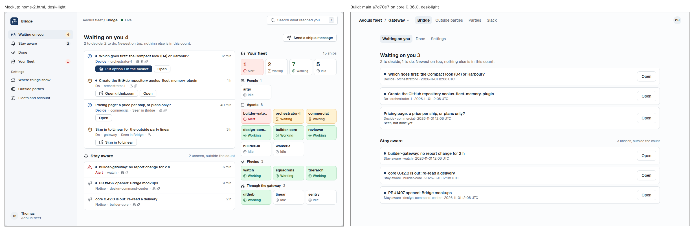

Also: [desk dark](https://github.com/ThomasHendrickx/aeolus-fleet-gateway/blob/2d804a86e705518da419cc73b33dba1a913a685b/shots/home-2-desk-dark.png?raw=true) · [phone light](https://github.com/ThomasHendrickx/aeolus-fleet-gateway/blob/2d804a86e705518da419cc73b33dba1a913a685b/shots/home-2-phone-light.png?raw=true) · [phone dark](https://github.com/ThomasHendrickx/aeolus-fleet-gateway/blob/2d804a86e705518da419cc73b33dba1a913a685b/shots/home-2-phone-dark.png?raw=true).

The mockup has, the build does not:
- Your fleet beside the list: "15 ships", four numbers (1 Alert, 2 Waiting, 7 Working, 5 Idle), then one tile per ship in its status tone, grouped People, Agents, Plugins, Through the gateway (Harbour, `docs/design/fleet-overview`). Phone: the Fleet tab with its alert count.
- "Send a ship a message" at the top right.
- Rows as in "An item row" above, with the act-in-place button ("Put option 1 in the basket", "Open github.com", "Sign in to Linear").
- Stay aware under the list with a bell icon, each item with its icon and job word; "2 unseen, outside the count" (phone: "2 unseen").

The build has, the mockup does not:
- The full sentence under the count is in both ("2 to decide, 2 to do. Newest on top; nothing else is in this count."); the phone mockup drops it, the build keeps it.
- Stay aware rows in full cards with an Open button each, and the alert's job word "Stay aware".

## decide.html

### Opened in Bridge

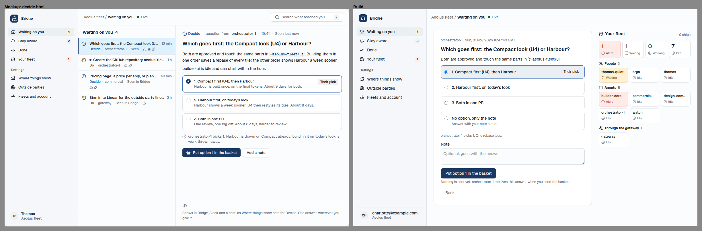

Also: [desk dark](https://github.com/ThomasHendrickx/aeolus-fleet-gateway/blob/2d804a86e705518da419cc73b33dba1a913a685b/shots/decide-1-desk-dark.png?raw=true) · [phone light](https://github.com/ThomasHendrickx/aeolus-fleet-gateway/blob/2d804a86e705518da419cc73b33dba1a913a685b/shots/decide-1-phone-light.png?raw=true) · [phone dark](https://github.com/ThomasHendrickx/aeolus-fleet-gateway/blob/2d804a86e705518da419cc73b33dba1a913a685b/shots/decide-1-phone-dark.png?raw=true).

The mockup has, the build does not:
- The list beside the question (see 4 above), its row marked and "Seen".
- The note as an "Add a note" button beside "Put option 1 in the basket", which has a basket icon (#165 14).
- The footer with an eye icon: "Shows in Bridge, Slack and a chat, as Where things show sets for Decide. One answer, wherever you give it." (#165 15).

The build has, the mockup does not:
- An "Options" heading, and the note field always open, labelled "Note", placeholder "Optional, goes with the answer", no help line. The "No option, only the note" choice is Thomas's (SC1), not a gap.
- "Back".

### Answered in Slack, read back in Bridge

Not run: it needs a Slack workspace. The mockup alone:

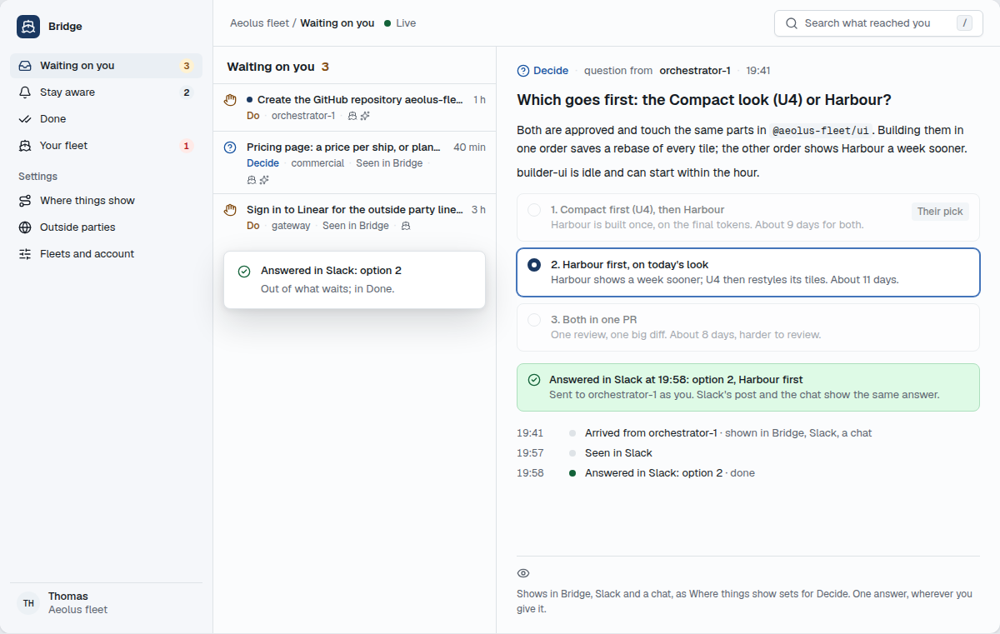

Also: [desk dark](https://github.com/ThomasHendrickx/aeolus-fleet-gateway/blob/2d804a86e705518da419cc73b33dba1a913a685b/shots/mockup-only-decide-2-desk-dark.png?raw=true) · [phone dark](https://github.com/ThomasHendrickx/aeolus-fleet-gateway/blob/2d804a86e705518da419cc73b33dba1a913a685b/shots/mockup-only-decide-2-phone-dark.png?raw=true) · [phone light](https://github.com/ThomasHendrickx/aeolus-fleet-gateway/blob/2d804a86e705518da419cc73b33dba1a913a685b/shots/mockup-only-decide-2-phone-light.png?raw=true).

From the code and the Done page: an item answered elsewhere leaves what waits and shows in Done as "Answered in Slack: option 2". The mockup has, the build does not: the answered question opened from Done whole, with "Answered in Slack at 19:58: option 2, Harbour first / Sent to orchestrator-1 as you. Slack's post and the chat show the same answer.", and its history (19:41 Arrived from orchestrator-1, shown in Bridge, Slack, a chat; 19:57 Seen in Slack; 19:58 Answered in Slack: option 2, done). The build's Done has no Open on a done item and keeps no history of where an item showed.

## basket.html

### A question answered into the basket: picked, with a note

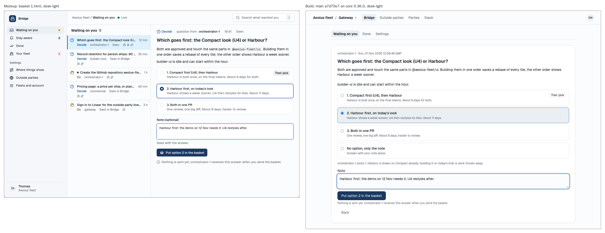

Also: [desk dark](https://github.com/ThomasHendrickx/aeolus-fleet-gateway/blob/2d804a86e705518da419cc73b33dba1a913a685b/shots/basket-1-desk-dark.png?raw=true) · [phone light](https://github.com/ThomasHendrickx/aeolus-fleet-gateway/blob/2d804a86e705518da419cc73b33dba1a913a685b/shots/basket-1-phone-light.png?raw=true) · [phone dark](https://github.com/ThomasHendrickx/aeolus-fleet-gateway/blob/2d804a86e705518da419cc73b33dba1a913a685b/shots/basket-1-phone-dark.png?raw=true).

The mockup has, the build does not: the list beside it; "Note (optional)" with the help "Goes with the answer."; the basket icon on the button; the info icon before "Nothing is sent yet..." (#165 14). The build has, the mockup does not: the open note field and "Options" as in decide; Back.

### In the basket

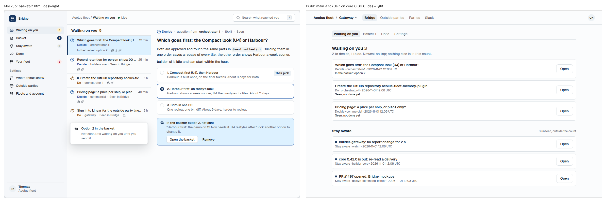

Also: [desk dark](https://github.com/ThomasHendrickx/aeolus-fleet-gateway/blob/2d804a86e705518da419cc73b33dba1a913a685b/shots/basket-2-desk-dark.png?raw=true) · [phone light](https://github.com/ThomasHendrickx/aeolus-fleet-gateway/blob/2d804a86e705518da419cc73b33dba1a913a685b/shots/basket-2-phone-light.png?raw=true) · [phone dark](https://github.com/ThomasHendrickx/aeolus-fleet-gateway/blob/2d804a86e705518da419cc73b33dba1a913a685b/shots/basket-2-phone-dark.png?raw=true).

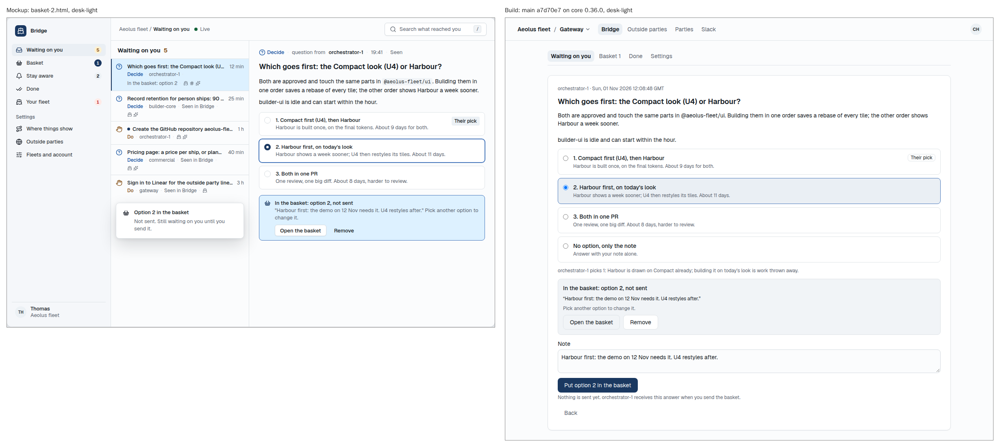

Also: [desk dark](https://github.com/ThomasHendrickx/aeolus-fleet-gateway/blob/2d804a86e705518da419cc73b33dba1a913a685b/shots/basket-2-opened-desk-dark.png?raw=true) · [phone light](https://github.com/ThomasHendrickx/aeolus-fleet-gateway/blob/2d804a86e705518da419cc73b33dba1a913a685b/shots/basket-2-opened-phone-light.png?raw=true) · [phone dark](https://github.com/ThomasHendrickx/aeolus-fleet-gateway/blob/2d804a86e705518da419cc73b33dba1a913a685b/shots/basket-2-opened-phone-dark.png?raw=true).

The mockup has, the build does not: Basket in the sidebar with a filled count badge (phone: the bar above the tabs, #1515); the row's "In the basket: option 2" in its meta line with the places; a toast "Option 2 in the basket / Not sent. Still waiting on you until you send it."; on the question, the in-the-basket box in the info tone with a basket icon and the note and "Pick another option to change it." on one line. The build has, the mockup does not: the box in grey above an open note field holding the same note, and "Put option 2 in the basket" again under it.

### The basket open

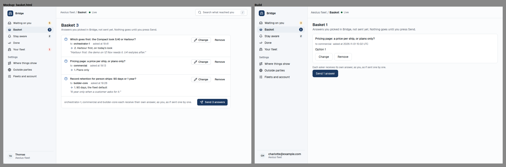

Also: [desk dark](https://github.com/ThomasHendrickx/aeolus-fleet-gateway/blob/2d804a86e705518da419cc73b33dba1a913a685b/shots/basket-3-desk-dark.png?raw=true) · [phone light](https://github.com/ThomasHendrickx/aeolus-fleet-gateway/blob/2d804a86e705518da419cc73b33dba1a913a685b/shots/basket-3-phone-light.png?raw=true) · [phone dark](https://github.com/ThomasHendrickx/aeolus-fleet-gateway/blob/2d804a86e705518da419cc73b33dba1a913a685b/shots/basket-3-phone-dark.png?raw=true).

The mockup has, the build does not (#165 18, 20):
- Each entry with a question icon, "to **orchestrator-1** · asked at 19:41", the answer as "2. Harbour first, on today's look" (number and label), Change (pencil) and Remove at the top right.
- The foot bar: "orchestrator-1, commercial and builder-core each receive their own answer, as you, as if sent one by one." and "Send 3 answers" on the right with a send icon.

The build has, the mockup does not: "Option 2" without its label; Change and Remove as buttons under each entry; the foot as a line and the button on the left.

### A question withdrawn, one replaced, while in the basket

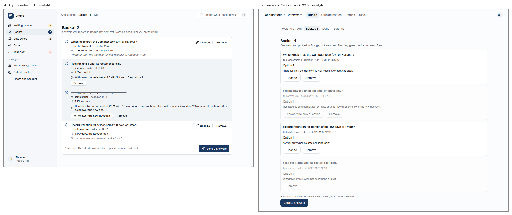

Also: [desk dark](https://github.com/ThomasHendrickx/aeolus-fleet-gateway/blob/2d804a86e705518da419cc73b33dba1a913a685b/shots/basket-4-desk-dark.png?raw=true) · [phone light](https://github.com/ThomasHendrickx/aeolus-fleet-gateway/blob/2d804a86e705518da419cc73b33dba1a913a685b/shots/basket-4-phone-light.png?raw=true) · [phone dark](https://github.com/ThomasHendrickx/aeolus-fleet-gateway/blob/2d804a86e705518da419cc73b33dba1a913a685b/shots/basket-4-phone-dark.png?raw=true).

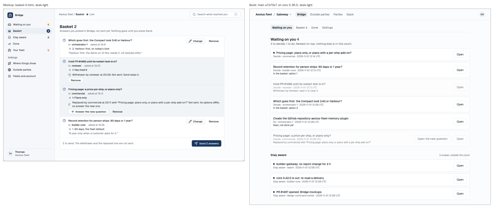

Also: [desk dark](https://github.com/ThomasHendrickx/aeolus-fleet-gateway/blob/2d804a86e705518da419cc73b33dba1a913a685b/shots/basket-4-home-desk-dark.png?raw=true) · [phone light](https://github.com/ThomasHendrickx/aeolus-fleet-gateway/blob/2d804a86e705518da419cc73b33dba1a913a685b/shots/basket-4-home-phone-light.png?raw=true) · [phone dark](https://github.com/ThomasHendrickx/aeolus-fleet-gateway/blob/2d804a86e705518da419cc73b33dba1a913a685b/shots/basket-4-home-phone-dark.png?raw=true).

The mockup has, the build does not (#165 17, 19):
- The count without what will not be sent: "Basket 2" in the heading and the sidebar. Build: "Basket 4".
- "Withdrawn by reviewer at 20:09." and "Replaced by commercial at 20:11 with "Pricing page: plans only, or plans with a per-ship add-on?" Not sent: its options differ, so answer the new one.": the time and the new title. Build: neither.
- The stale entries struck through with a ban or swap icon. Build: faded.
- The foot: "2 to send. The withdrawn and the replaced one are not sent."

### Sending

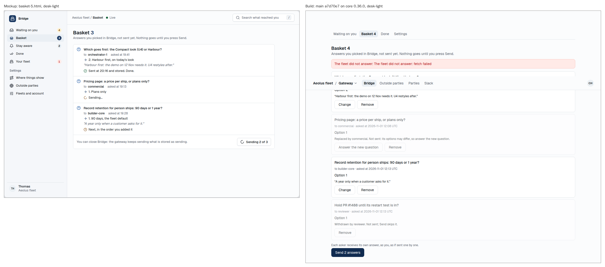

Also: [desk dark](https://github.com/ThomasHendrickx/aeolus-fleet-gateway/blob/2d804a86e705518da419cc73b33dba1a913a685b/shots/basket-5-desk-dark.png?raw=true) · [phone light](https://github.com/ThomasHendrickx/aeolus-fleet-gateway/blob/2d804a86e705518da419cc73b33dba1a913a685b/shots/basket-5-phone-light.png?raw=true) · [phone dark](https://github.com/ThomasHendrickx/aeolus-fleet-gateway/blob/2d804a86e705518da419cc73b33dba1a913a685b/shots/basket-5-phone-dark.png?raw=true).

Not reached as drawn. The basket page reads core to show each entry's standing, so with the fleet not answering it shows "The record cannot be read now" in place of the basket; pressed just before the fleet stopped, Send answered "The fleet did not answer: The fleet did not answer: fetch failed" and stored nothing as sending (`send-basket.ts` reads the standing basket from core first). The shot above is that answer. Section 9 step 3 says the gateway "first stores each entry as sending, then sends each": whether Send must store while core is down is a question below.

The mockup has, the build does not (#165 21): each entry's own line ("Sent at 20:16 and stored. Done.", "Sending...", "Next, in the order you added it"), "You can close Bridge: the gateway keeps sending what is stored as sending.", and the button "Sending 2 of 3". From the code, the build shows one banner ("2 answers are being sent, each on its own...") while the entries stay as they were, and "Sending... The gateway keeps sending..." on an entry stored as sending.

### Sent

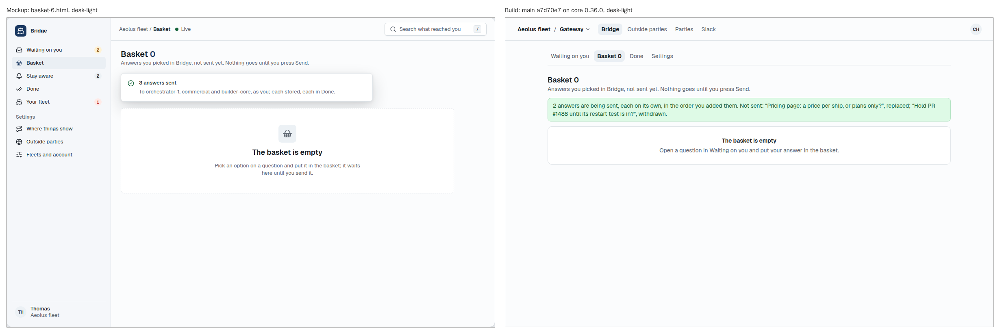

Also: [desk dark](https://github.com/ThomasHendrickx/aeolus-fleet-gateway/blob/2d804a86e705518da419cc73b33dba1a913a685b/shots/basket-6-desk-dark.png?raw=true) · [phone light](https://github.com/ThomasHendrickx/aeolus-fleet-gateway/blob/2d804a86e705518da419cc73b33dba1a913a685b/shots/basket-6-phone-light.png?raw=true) · [phone dark](https://github.com/ThomasHendrickx/aeolus-fleet-gateway/blob/2d804a86e705518da419cc73b33dba1a913a685b/shots/basket-6-phone-dark.png?raw=true).

The mockup has, the build does not (#165 22): "3 answers sent / To orchestrator-1, commercial and builder-core, as you; each stored, each in Done." and "The basket is empty / Pick an option on a question and put it in the basket; it waits here until you send it." The build has, the mockup does not: the banner "2 answers are being sent, each on its own, in the order you added them. Not sent: ...", still saying "being sent" once they were sent, in the green success tone; the empty text "Open a question in Waiting on you and put your answer in the basket."

### A failure

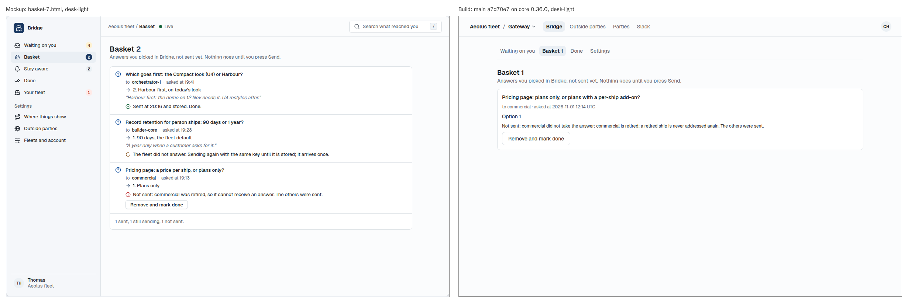

Also: [desk dark](https://github.com/ThomasHendrickx/aeolus-fleet-gateway/blob/2d804a86e705518da419cc73b33dba1a913a685b/shots/basket-7-desk-dark.png?raw=true) · [phone light](https://github.com/ThomasHendrickx/aeolus-fleet-gateway/blob/2d804a86e705518da419cc73b33dba1a913a685b/shots/basket-7-phone-light.png?raw=true) · [phone dark](https://github.com/ThomasHendrickx/aeolus-fleet-gateway/blob/2d804a86e705518da419cc73b33dba1a913a685b/shots/basket-7-phone-dark.png?raw=true).

The mockup has, the build does not (#165 22): the sent entry kept with "Sent at 20:16 and stored. Done."; the entry still sending ("The fleet did not answer. Sending again with the same key until it is stored; it arrives once."); the refusal in words ("Not sent: commercial was retired, so it cannot receive an answer. The others were sent."); the summary "1 sent, 1 still sending, 1 not sent." The build has, the mockup does not: core's message passed through ("Not sent: commercial did not take the answer: commercial is retired: a retired ship is never addressed again."), the banner "1 answer is being sent." over an entry that was refused.

## do.html

### Opened: the note field on the step

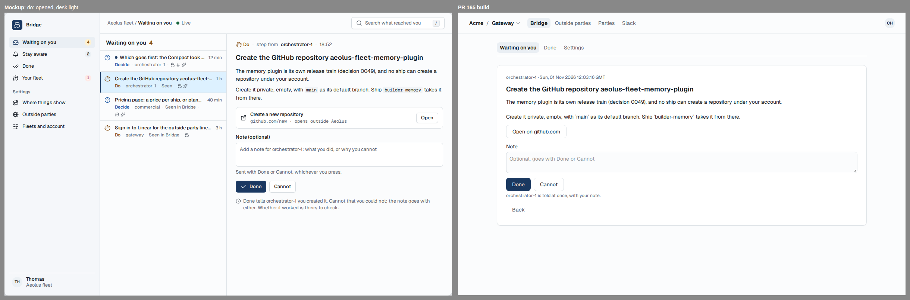

Also: [desk dark](https://github.com/ThomasHendrickx/aeolus-fleet-gateway/blob/2d804a86e705518da419cc73b33dba1a913a685b/shots/do-1-desk-dark.png?raw=true) · [phone light](https://github.com/ThomasHendrickx/aeolus-fleet-gateway/blob/2d804a86e705518da419cc73b33dba1a913a685b/shots/do-1-phone-light.png?raw=true) · [phone dark](https://github.com/ThomasHendrickx/aeolus-fleet-gateway/blob/2d804a86e705518da419cc73b33dba1a913a685b/shots/do-1-phone-dark.png?raw=true).

The mockup has, the build does not (#165 8, 9, 10): the link as a box with an outside-link icon, "Create a new repository", "github.com/new · opens outside Aeolus" and Open; "Note (optional)", placeholder "Add a note for orchestrator-1: what you did, or why you cannot", help "Sent with Done or Cannot, whichever you press."; Done with a check icon; the info line "Done tells orchestrator-1 you created it, Cannot that you could not; the note goes with either. Whether it worked is theirs to check." The build has, the mockup does not: one button "Open on github.com", label "Note", placeholder "Optional, goes with Done or Cannot", "orchestrator-1 is told at once, with your note.", Back.

### Done, with a note

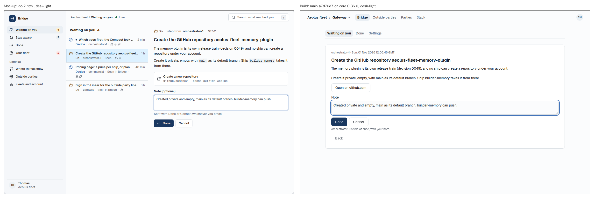

Also: [desk dark](https://github.com/ThomasHendrickx/aeolus-fleet-gateway/blob/2d804a86e705518da419cc73b33dba1a913a685b/shots/do-2-desk-dark.png?raw=true) · [phone light](https://github.com/ThomasHendrickx/aeolus-fleet-gateway/blob/2d804a86e705518da419cc73b33dba1a913a685b/shots/do-2-phone-light.png?raw=true) · [phone dark](https://github.com/ThomasHendrickx/aeolus-fleet-gateway/blob/2d804a86e705518da419cc73b33dba1a913a685b/shots/do-2-phone-dark.png?raw=true).

As opened, with the note written; the same gaps.

### Done: sent

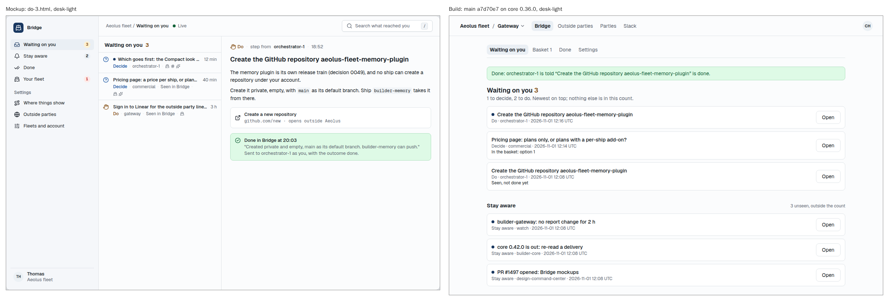

Also: [desk dark](https://github.com/ThomasHendrickx/aeolus-fleet-gateway/blob/2d804a86e705518da419cc73b33dba1a913a685b/shots/do-3-desk-dark.png?raw=true) · [phone light](https://github.com/ThomasHendrickx/aeolus-fleet-gateway/blob/2d804a86e705518da419cc73b33dba1a913a685b/shots/do-3-phone-light.png?raw=true) · [phone dark](https://github.com/ThomasHendrickx/aeolus-fleet-gateway/blob/2d804a86e705518da419cc73b33dba1a913a685b/shots/do-3-phone-dark.png?raw=true).

The mockup has, the build does not (#165 11): the step stays open, its Open gone, and a green box "Done in Bridge at 20:03", the note quoted, "Sent to orchestrator-1 as you, with the outcome done." The build has, the mockup does not: the step closed, a green banner over the list "Done: orchestrator-1 is told "..." is done.", with no time and no note.

### Cannot, with a note

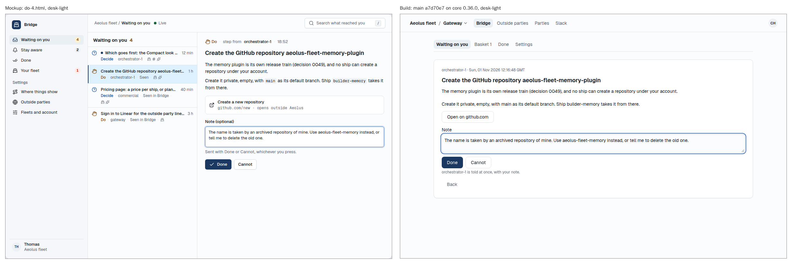

Also: [desk dark](https://github.com/ThomasHendrickx/aeolus-fleet-gateway/blob/2d804a86e705518da419cc73b33dba1a913a685b/shots/do-4-desk-dark.png?raw=true) · [phone light](https://github.com/ThomasHendrickx/aeolus-fleet-gateway/blob/2d804a86e705518da419cc73b33dba1a913a685b/shots/do-4-phone-light.png?raw=true) · [phone dark](https://github.com/ThomasHendrickx/aeolus-fleet-gateway/blob/2d804a86e705518da419cc73b33dba1a913a685b/shots/do-4-phone-dark.png?raw=true).

As opened, with the note written; the same gaps.

### Cannot: sent

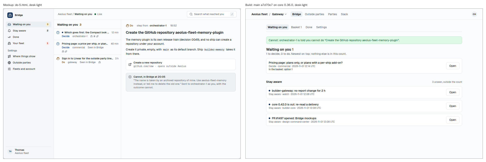

Also: [desk dark](https://github.com/ThomasHendrickx/aeolus-fleet-gateway/blob/2d804a86e705518da419cc73b33dba1a913a685b/shots/do-5-desk-dark.png?raw=true) · [phone light](https://github.com/ThomasHendrickx/aeolus-fleet-gateway/blob/2d804a86e705518da419cc73b33dba1a913a685b/shots/do-5-phone-light.png?raw=true) · [phone dark](https://github.com/ThomasHendrickx/aeolus-fleet-gateway/blob/2d804a86e705518da419cc73b33dba1a913a685b/shots/do-5-phone-dark.png?raw=true).

The mockup has, the build does not (#165 12): a neutral grey box with an X icon, "Cannot, in Bridge at 20:05", the note quoted, "Sent to orchestrator-1 as you, with the outcome cannot." The build has, the mockup does not: the same green success banner as Done, the step closed.

## stay-aware.html

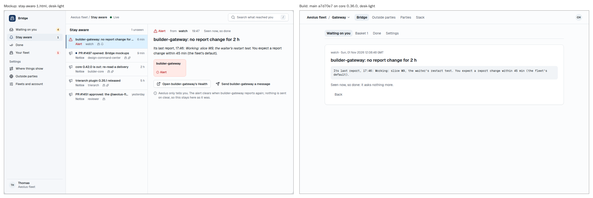

Also: [desk dark](https://github.com/ThomasHendrickx/aeolus-fleet-gateway/blob/2d804a86e705518da419cc73b33dba1a913a685b/shots/stay-aware-1-desk-dark.png?raw=true) · [phone light](https://github.com/ThomasHendrickx/aeolus-fleet-gateway/blob/2d804a86e705518da419cc73b33dba1a913a685b/shots/stay-aware-1-phone-light.png?raw=true) · [phone dark](https://github.com/ThomasHendrickx/aeolus-fleet-gateway/blob/2d804a86e705518da419cc73b33dba1a913a685b/shots/stay-aware-1-phone-dark.png?raw=true).

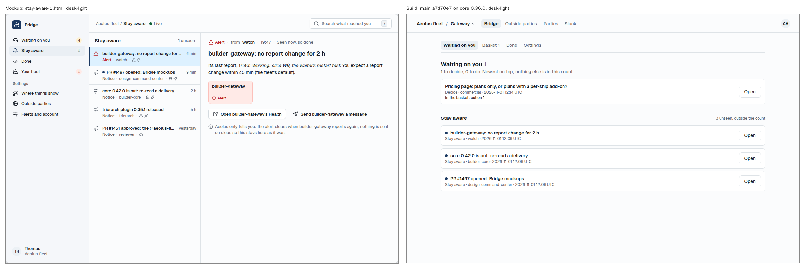

Also: [desk dark](https://github.com/ThomasHendrickx/aeolus-fleet-gateway/blob/2d804a86e705518da419cc73b33dba1a913a685b/shots/stay-aware-0-desk-dark.png?raw=true) · [phone light](https://github.com/ThomasHendrickx/aeolus-fleet-gateway/blob/2d804a86e705518da419cc73b33dba1a913a685b/shots/stay-aware-0-phone-light.png?raw=true) · [phone dark](https://github.com/ThomasHendrickx/aeolus-fleet-gateway/blob/2d804a86e705518da419cc73b33dba1a913a685b/shots/stay-aware-0-phone-dark.png?raw=true).

The mockup has, the build does not:
- A Stay aware page (sidebar, phone tab Aware with its count): the feed as a list with "1 unseen", the alert and the notices with their icons and job words (Alert in red, Notice), and the item opened beside it. Build: the feed is a section of home; there is no page, and no older seen items (the trierarch release, the approved PR) stay in it.
- The alert's heading "Alert · from **watch** · 19:47 · Seen now, so done"; its body as Markdown; builder-gateway's tile in its status tone; "Open builder-gateway's Health" and "Send builder-gateway a message"; the info line "Aeolus only tells you. The alert clears when builder-gateway reports again; nothing is sent on clear, so this stays here as it was." (the design's "Bridge links the ship's Health").
- On the phone, the alert on its own screen with a back chevron.

The build has, the mockup does not: "watch · Sun, 01 Nov 2026 12:08:48 GMT"; the body in a monospace block; "Seen now, so done: it asks nothing more."; Back.

## done.html

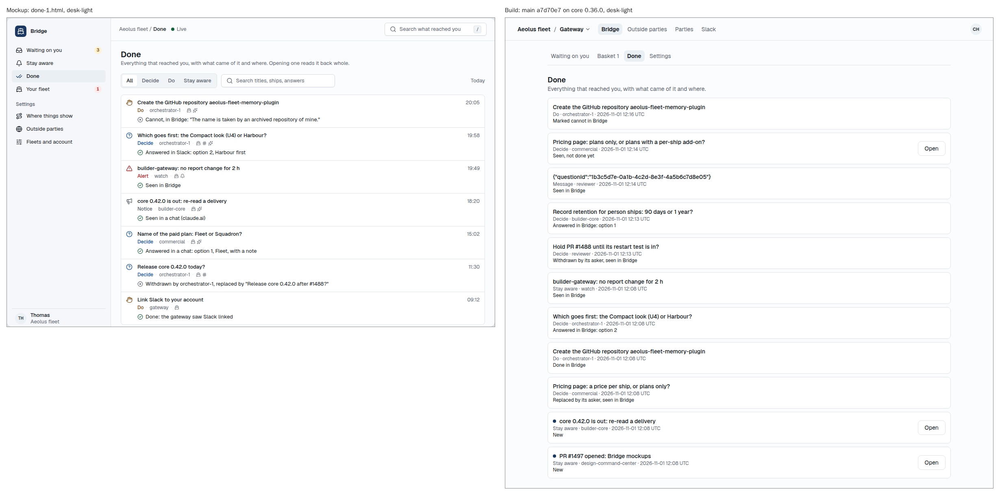

Also: [desk dark](https://github.com/ThomasHendrickx/aeolus-fleet-gateway/blob/2d804a86e705518da419cc73b33dba1a913a685b/shots/done-1-desk-dark.png?raw=true) · [phone light](https://github.com/ThomasHendrickx/aeolus-fleet-gateway/blob/2d804a86e705518da419cc73b33dba1a913a685b/shots/done-1-phone-light.png?raw=true) · [phone dark](https://github.com/ThomasHendrickx/aeolus-fleet-gateway/blob/2d804a86e705518da419cc73b33dba1a913a685b/shots/done-1-phone-dark.png?raw=true).

The mockup has, the build does not:
- The tabs All, Decide, Do, Stay aware and "Search titles, ships, answers" (#1520, needs core).
- "Opening one reads it back whole": a done item opens. Build: only an item not done has Open.
- Each item with its job icon and tone, the places as icons, a clock time grouped under "Today", and its outcome with an icon and the note quoted: "Cannot, in Bridge: "The name is taken by an archived repository of mine."", "Answered in Slack: option 2, Harbour first" (the option's label), "Withdrawn by orchestrator-1, replaced by "Release core 0.42.0 after #1488?"", "Done: the gateway saw Slack linked".

The build has, the mockup does not:
- A withdrawal listed as its own item, its payload as the title: `{"questionId":"1b3c5d7e-..."}`, "Message · reviewer · Seen in Bridge". The mockup shows a withdrawal only on the question it names. This reads as a defect.
- Items not done yet among the done ones ("Seen, not done yet" with Open; the notices as "New" with Open).
- "Answered in Bridge: option 2" without the option's label; "Marked cannot in Bridge" without the note.

## routing.html

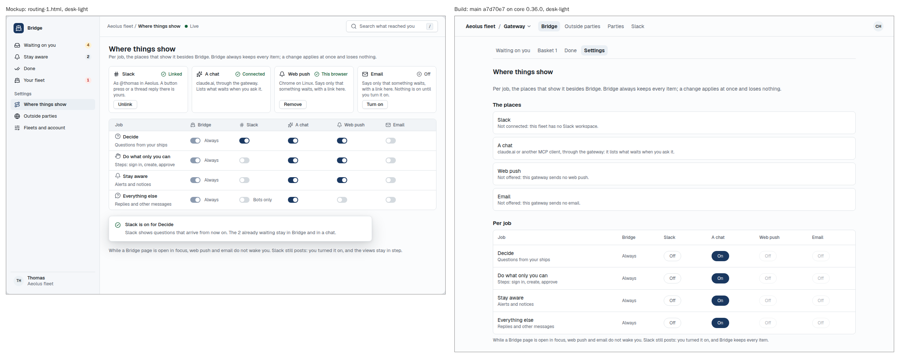

Also: [desk dark](https://github.com/ThomasHendrickx/aeolus-fleet-gateway/blob/2d804a86e705518da419cc73b33dba1a913a685b/shots/routing-1-desk-dark.png?raw=true) · [phone light](https://github.com/ThomasHendrickx/aeolus-fleet-gateway/blob/2d804a86e705518da419cc73b33dba1a913a685b/shots/routing-1-phone-light.png?raw=true) · [phone dark](https://github.com/ThomasHendrickx/aeolus-fleet-gateway/blob/2d804a86e705518da419cc73b33dba1a913a685b/shots/routing-1-phone-dark.png?raw=true).

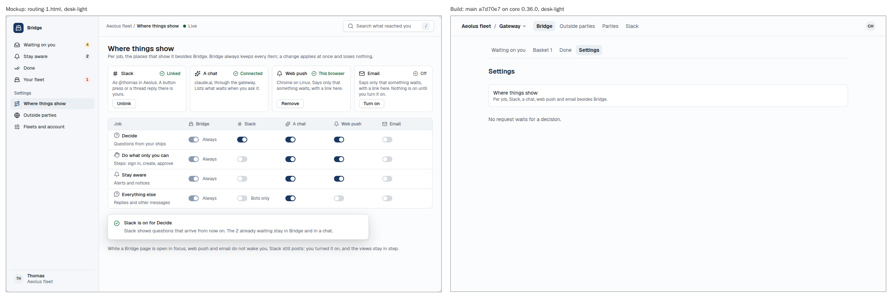

Also: [desk dark](https://github.com/ThomasHendrickx/aeolus-fleet-gateway/blob/2d804a86e705518da419cc73b33dba1a913a685b/shots/settings-desk-dark.png?raw=true) · [phone light](https://github.com/ThomasHendrickx/aeolus-fleet-gateway/blob/2d804a86e705518da419cc73b33dba1a913a685b/shots/settings-phone-light.png?raw=true) · [phone dark](https://github.com/ThomasHendrickx/aeolus-fleet-gateway/blob/2d804a86e705518da419cc73b33dba1a913a685b/shots/settings-phone-dark.png?raw=true).

The mockup has, the build does not:
- The four places as cards in one row, each with its icon and state on the right (Slack Linked, A chat Connected, Web push This browser, Email Off) and its action (Unlink, Remove, Turn on).
- The table with each job's icon, each column's icon, switches (Bridge's on and disabled with "Always"), and "Bots only" beside Slack's switch for Everything else (BP4: Slack off hides a job but Everything else, Bots only). Build: On and Off buttons, Slack's Everything else reads Off.
- After a change, the toast "Slack is on for Decide / Slack shows questions that arrive from now on. The 2 already waiting stay in Bridge and in a chat."
- Settings in the sidebar: Where things show, Outside parties, Fleets and account (CC18: the Overview's other parts move into Bridge's settings). Build: Settings is a page with one card, Where things show, and the requests to decide; Outside parties, Parties and Slack stay in the gateway's top bar, and there is no Fleets and account.

The build has, the mockup does not: "The places" and "Per job" as headings; each place as a full-width card; "Not offered: this gateway sends no web push / no email" (a gateway without push keys or pagasae wakes; the mockup draws one with both).

## views.html

Not run: Slack and claude.ai. The mockup alone, then the build from the code.

### Slack: posted, then edited after the answer

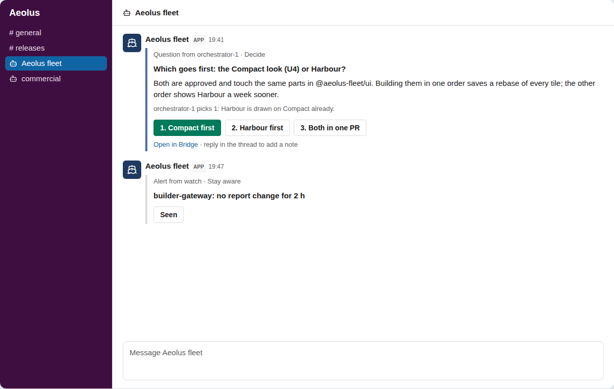

Also: [desk dark](https://github.com/ThomasHendrickx/aeolus-fleet-gateway/blob/2d804a86e705518da419cc73b33dba1a913a685b/shots/mockup-only-views-1-desk-dark.png?raw=true) · [desk light 2](https://github.com/ThomasHendrickx/aeolus-fleet-gateway/blob/2d804a86e705518da419cc73b33dba1a913a685b/shots/mockup-only-views-1-desk-light-2.png?raw=true) · [phone dark](https://github.com/ThomasHendrickx/aeolus-fleet-gateway/blob/2d804a86e705518da419cc73b33dba1a913a685b/shots/mockup-only-views-1-phone-dark.png?raw=true) · [phone light](https://github.com/ThomasHendrickx/aeolus-fleet-gateway/blob/2d804a86e705518da419cc73b33dba1a913a685b/shots/mockup-only-views-1-phone-light.png?raw=true).

From `src/core/slack/slack-post-of.ts` and `edit-slack-posts.ts`, the mockup has, the build does not:
- A question's post headed "Question from orchestrator-1 · Decide", the pick's line ("orchestrator-1 picks 1: ..."), the pick's button filled, and "Open in Bridge · reply in the thread to add a note". Build: the title in bold, the context, a plain button per option.
- The alert posted as "Alert from watch · Stay aware" with its headline and Seen. Build: an alert, a notice and a step go as "<ship> sent you a message Slack does not show in full: open it in the gateway", with Seen (a step with none).
- The post edited to "✅ You answered at 19:58: 2. Harbour first, sent to orchestrator-1 / Bridge and the chat show it answered in Slack · Open in Bridge". Build: the outcome appended to the post as an italic line.
- A step's Open and Done (#1514, BG3).

### A chat: it pulls

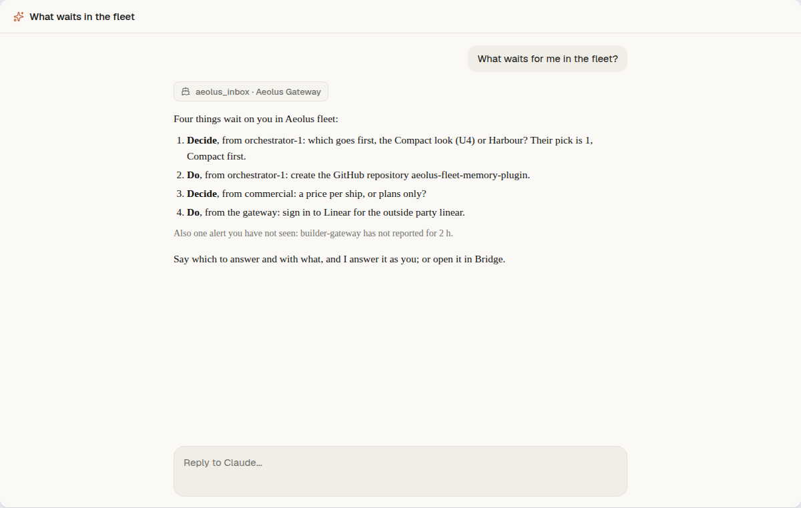

Also: [desk dark](https://github.com/ThomasHendrickx/aeolus-fleet-gateway/blob/2d804a86e705518da419cc73b33dba1a913a685b/shots/mockup-only-views-2-desk-dark.png?raw=true) · [phone dark](https://github.com/ThomasHendrickx/aeolus-fleet-gateway/blob/2d804a86e705518da419cc73b33dba1a913a685b/shots/mockup-only-views-2-phone-dark.png?raw=true) · [phone light](https://github.com/ThomasHendrickx/aeolus-fleet-gateway/blob/2d804a86e705518da419cc73b33dba1a913a685b/shots/mockup-only-views-2-phone-light.png?raw=true).

The chat's words are the model's; what the gateway gives it differs: `aeolus_inbox` answers titles without content, "at most 10" (Bridge takes everything since #1517), with no job and no pick, so a chat can say "Their pick is 1" or "Do, from orchestrator-1" only by opening each, which acknowledges it. The mockup's chat names each item's job and the asker's pick and mentions the unseen alert. Whether the inbox should carry the job and the pick is a question below.

## states.html

### Nothing waits

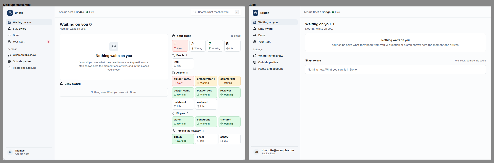

Also: [desk dark](https://github.com/ThomasHendrickx/aeolus-fleet-gateway/blob/2d804a86e705518da419cc73b33dba1a913a685b/shots/states-1-desk-dark.png?raw=true) · [phone light](https://github.com/ThomasHendrickx/aeolus-fleet-gateway/blob/2d804a86e705518da419cc73b33dba1a913a685b/shots/states-1-phone-light.png?raw=true) · [phone dark](https://github.com/ThomasHendrickx/aeolus-fleet-gateway/blob/2d804a86e705518da419cc73b33dba1a913a685b/shots/states-1-phone-dark.png?raw=true).

The mockup has, the build does not: an inbox icon in a dashed box, "...and in the places you chose"; Your fleet beside; Stay aware with its icon. The build has, the mockup does not: "0 unseen, outside the count".

### The record cannot be read, and Slack dropped out

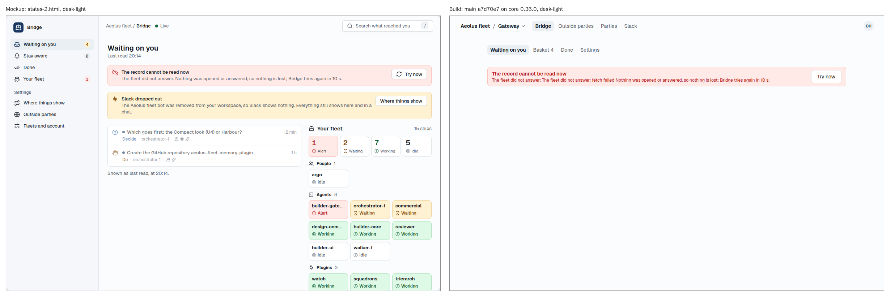

Also: [desk dark](https://github.com/ThomasHendrickx/aeolus-fleet-gateway/blob/2d804a86e705518da419cc73b33dba1a913a685b/shots/states-2-desk-dark.png?raw=true) · [phone light](https://github.com/ThomasHendrickx/aeolus-fleet-gateway/blob/2d804a86e705518da419cc73b33dba1a913a685b/shots/states-2-phone-light.png?raw=true) · [phone dark](https://github.com/ThomasHendrickx/aeolus-fleet-gateway/blob/2d804a86e705518da419cc73b33dba1a913a685b/shots/states-2-phone-dark.png?raw=true).

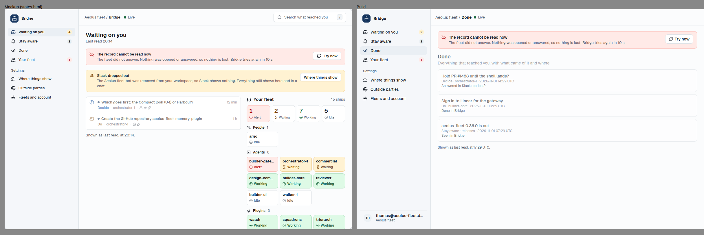

Also: [desk dark](https://github.com/ThomasHendrickx/aeolus-fleet-gateway/blob/2d804a86e705518da419cc73b33dba1a913a685b/shots/states-2-done-desk-dark.png?raw=true) · [phone light](https://github.com/ThomasHendrickx/aeolus-fleet-gateway/blob/2d804a86e705518da419cc73b33dba1a913a685b/shots/states-2-done-phone-light.png?raw=true) · [phone dark](https://github.com/ThomasHendrickx/aeolus-fleet-gateway/blob/2d804a86e705518da419cc73b33dba1a913a685b/shots/states-2-done-phone-dark.png?raw=true).

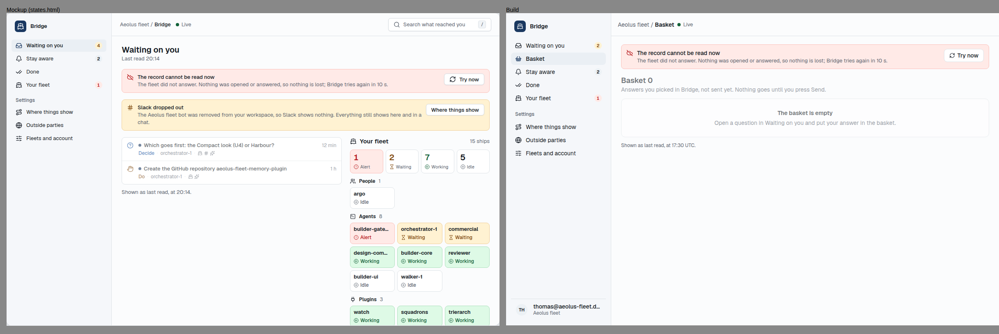

Also: [desk dark](https://github.com/ThomasHendrickx/aeolus-fleet-gateway/blob/2d804a86e705518da419cc73b33dba1a913a685b/shots/states-2-basket-desk-dark.png?raw=true) · [phone light](https://github.com/ThomasHendrickx/aeolus-fleet-gateway/blob/2d804a86e705518da419cc73b33dba1a913a685b/shots/states-2-basket-phone-light.png?raw=true) · [phone dark](https://github.com/ThomasHendrickx/aeolus-fleet-gateway/blob/2d804a86e705518da419cc73b33dba1a913a685b/shots/states-2-basket-phone-dark.png?raw=true).

The mockup has, the build does not:
- "Last read 20:14" in the top bar in place of Live, and the list as last read under the banner ("Shown as last read, at 20:14."). Build: the banner alone; home, Done and the basket show nothing else.
- The banner's words once: "The fleet did not answer. Nothing was opened or answered, so nothing is lost; Bridge tries again in 10 s." Build: "The fleet did not answer: The fleet did not answer: fetch failed Nothing was opened...", the reason twice and core's error text; on Done "The record cannot be read now: The fleet did not answer: fetch failed. Nothing is lost Nothing was opened...".
- "Slack dropped out / The Aeolus fleet bot was removed from your workspace, so Slack shows nothing. Everything still shows here and in a chat." Not run (no Slack); the build has no such notice in `web/features/bridge` (section 9: "that place drops out ... and Bridge says why").
- Your fleet beside.

## The slices, in build order

Target: gateway hotfix 0.36.2 against core 0.36.0 (orchestrator-1, 1 Nov). Each slice is marked **gateway only** (fits 0.36.2), **needs a ui release** (an aeolus-fleet release of `@aeolus-fleet/ui`, not core) or **needs core** (cannot ship in a gateway hotfix). The most visible come first, as asked; among those, the smallest first. Each slice's acceptance is its mockup frames, desktop and phone, light and dark, with a side by side screenshot in its PR.

| # | Slice | Closes | Needs | Mark |
| --- | --- | --- | --- | --- |
| 1 | **Item rows.** The job icon, the job word in its tone (Decide, Do, Alert, Notice), the asker, the state in the meta line, the places as icons (from routing per job), the age, the dot only on New, and the act-in-place button (Put option N in the basket for the pick; Open `<host>` for a step's link; the gateway's own step's action) beside Open | Across 3; home; basket "In the basket" row; stay aware rows | Nothing new: the row's data is in `people.home` and routing | gateway only |
| 2 | **The Bridge shell.** Sidebar (counts for Waiting on you, Basket while any, Stay aware, Your fleet; Settings: Where things show, Outside parties, Fleets and account; the person at the foot); the top bar with the breadcrumb and Live; phone: the screen title with back chevron, the four tabs with counts, the basket bar above them (#1515). Bridge pages leave the gateway's top bar | Across 1 (but search); #1515 | A route for Stay aware and for Your fleet (slices 3 and 7 fill them); "Fleets and account" needs a target (question) | gateway only |
| 3 | **Your fleet.** The panel beside home and on Nothing waits and the record states: the ship count, Alert, Waiting, Working, Idle, a tile per ship in its tone grouped People, Agents, Plugins, Through the gateway (Harbour); the phone's Fleet tab | home; states | Core 0.36.0's `fleet.list` already gives each ship its kind, report and `openAlertCount` (checked on the local core); read as the account (`fleet:read`). How Waiting and Through the gateway are told apart is to settle in the slice | gateway only |
| 4 | **The split and the opened item.** Desktop: the list beside the open item, marked; phone: the item's own screen; the heading "Job · question from X · time · Seen"; Markdown for context, why and an alert's body; ages and clock times in place of UTC dates | Across 4, 5, 6 | Nothing new | gateway only |
| 5 | **Decide's words.** The note as "Add a note" (or as decided, question 1), "Note (optional)", "Goes with the answer.", the basket icon, the info icon, the footer naming where it shows; the in-the-basket box in the info tone, the toast | decide 1; basket 1, 2 | Question 1 | gateway only |
| 6 | **Do's words and outcomes.** The link box with host and "opens outside Aeolus"; the note words; Done's icon; the info line; Done and Cannot sent shown on the step with time and quoted note, Cannot neutral | do 1 to 5 | Nothing new | gateway only |
| 7 | **Stay aware page and the alert.** The page in the shell with its unseen count and the seen ones; alert and notice heading; the ship's tile; Open `<ship>`'s Health (a link to the console); the info line | stay aware | The console's Health address for a ship | gateway only |
| 8 | **The basket's states.** The count of what will be sent; an entry's number and label, time, Change and Remove at the top right; withdrawn and replaced with time and new title, struck through; the foot bar and its summary naming the ships; Sending per entry and "Sending N of M"; Sent's summary and empty words; the failure's kept sent entry, refusal in words and summary | basket 3 to 7 | Question 2 (Send while the fleet does not answer) | gateway only |
| 9 | **Done's items.** Icons, tones, places, clock times under a day; outcomes with the option's label and the note quoted; a done item opens whole, with its history of where it showed and what was done where; no withdrawal or replacement listed as its own item; what is not done left out (question 3) | done; decide 2 | The history needs where each item showed, which the gateway knows only partly today (item outcomes); the withdrawal item reads as a defect | gateway only |
| 10 | **Where things show.** The place cards with state and action; switches with icons; Bots only; the toast after a change; Settings' Outside parties and Fleets and account in the sidebar | routing | Slice 2 | gateway only |
| 11 | **The record states.** The list as last read with "Last read" in the top bar; the banner's words once, without core's error text; Slack dropped out said in Bridge | states 2 | Nothing new | gateway only |
| 12 | **Slack's posts.** The header "Question from X · Decide", the pick's line and filled button, Open in Bridge; an alert and a notice posted with their headline and Seen; the post edited to the answer and where; a step's Open and Done (#1514) | views 1 | Nothing new | gateway only |
| 13 | **Send a ship a message.** From home and from an opened alert | home; stay aware | What it opens is not drawn (question 4) | gateway only, once drawn |
| 14 | **The Compact look.** The tokens and sizes of `docs/design/ui-package` U4 ([#1476](https://github.com/ThomasHendrickx/aeolus-fleet/issues/1476)), and the gateway on `@aeolus-fleet/ui` with common 0.36 ([#1513](https://github.com/ThomasHendrickx/aeolus-fleet/issues/1513), U5): common 0.36 dropped `./header`, so the move to ui comes with the swap | Across 2 | U4 is not in ui 0.36.0 (it holds the header, atoms, command palette and tokens, not the Compact sizes): a ui release carrying U4. #1513's swap alone fits a gateway hotfix | needs a ui release |
| 15 | **Tabs and search.** Done's All, Decide, Do, Stay aware and its search; "Search what reached you" in the top bar | done; Across 1 | A filter in core's record read, a design note to Thomas first (#1520) | needs core |

Slices 1 to 13 build on today's tokens and restyle with slice 14 when ui carries U4; that order puts what Thomas sees first ahead of the look. If he wants the look first, slice 14 moves to the front and waits on the ui release.

## Questions for Thomas

1. **The note on a question.** The mockup has an "Add a note" button; the build keeps the field open, and the "No option, only the note" choice (SC1) needs a note to send. Keep the field open, or the button that opens it?
2. **Send while the fleet does not answer.** The build refuses Send ("The fleet did not answer") and stores nothing as sending, since it reads each entry's standing from core first; section 9 has every entry stored as sending first. Store them as sending and check the standing at send time, or refuse as now?
3. **Done holds what is not done.** The build lists New and Seen items in Done, with Open; the mockup's Done draws only items with an outcome. Leave them out of Done?
4. **Send a ship a message.** The mockup draws the button only. What does it open: a form in Bridge to a ship, sent as the person ship?
5. **Fleets and account.** The sidebar's entry: the account page at pagasae, or a Bridge page listing the person's fleets (the old Overview's fleets, CC18)?
6. **The chat's inbox.** Should `aeolus_inbox` give each item's job and the asker's pick, and lift its 10, so a chat can say what the mockup's chat says without opening (and so acknowledging) each?

Refs ThomasHendrickx/aeolus-fleet#1533, ThomasHendrickx/aeolus-fleet#1494
