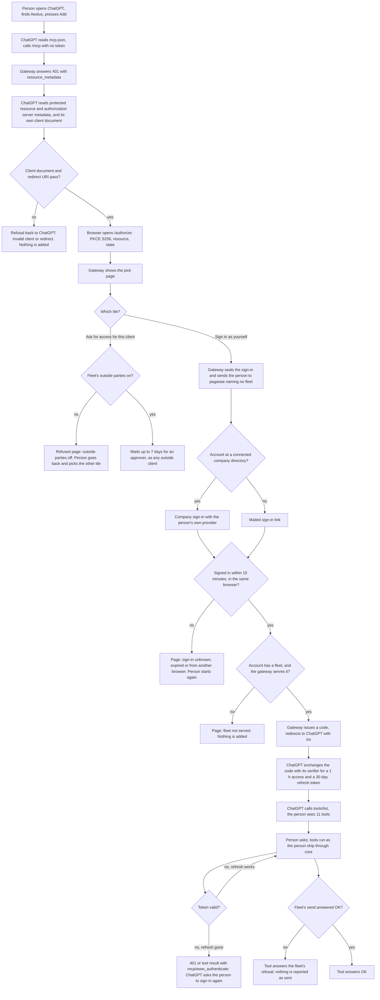

# Aeolus in ChatGPT's plugin directory

Design by designer-chatgpt, stage 2: the design and its acceptance criteria. Source: aeolus-fleet#1214, with Thomas, 27 Oct: "For chatgpt i want to have an official plugin. Those work and install 100x better than plain mcp".

OpenAI's pages read on 27 Oct, all under developers.openai.com: [S] apps-sdk/deploy/submission, [B] plugins/build/plugins, [G] plugins/plugin-guidelines (also served at apps-sdk/app-submission-guidelines), [A] apps-sdk/build/auth. OpenAI has renamed "apps" to "plugins"; the directory is shared by ChatGPT and Codex.

## 1. Purpose

**What it is.** The gateway's connection, named "Aeolus", listed in ChatGPT's Plugins directory. It is a ZIP of two files, `plugin.json` and `mcp.json`, that points ChatGPT at `https://gateway.aeolus-fleet.dev/mcp`. It adds no new behaviour: the person reaches the fleet through the same endpoint, sign-in and tools as today.

**For whom.** A person in a fleet on the hosted Aeolus, working in ChatGPT: someone who is given the right to talk with the fleet and is not technical enough to paste a connector address.

**A good outcome.**
- The person finds Aeolus in the directory, adds it in one step, signs in as they sign in to Aeolus everywhere, and sees their inbox, who they may send to, and their meetings, with nothing else to set up.
- ChatGPT shows and allows exactly what core answers for that person's ship (policy stays in core), and no message is lost or answered before `send` answered OK.
- Each gateway release that changes a tool reaches the directory with no step of ours beyond a Rescan, or fails visibly; OpenAI's own approval of a new tool is theirs.
- OpenAI's reviewers get in without help from us and approve on the first or second attempt.

**Not in this purpose.** A self-hosted gateway on its own address (the listing's server address is fixed, and changing it needs OpenAI support, [S]); a ChatGPT that is an outside party calling fleet ships as tools; the A2A adapter; Claude's directory.

## 2. Lessons to check against

| Lesson | Source | Bearing |
| --- | --- | --- |
| Sign-in is pagasae's mailed link only, or the company identity once a directory is connected. The gateway has no password, test account or bypass. | decision 0054; flows.md F5; gateway code `src/core/sign-in/start-sign-in.ts` | OpenAI refuses sign-in by magic link, email code or MFA for reviewers, and rejects plugins that need extra login steps ([S], [G]) |
| Policy stays in core: the gateway shows and allows exactly what core answers for the actor. A fleet's tool switches ("Every tool needs") are the gateway's, set per fleet. | gateway CLAUDE.md; decisions 0043, 0046, 0057; gateway commits `276aed2` (S3), `22e68cc` (S4) | The tool list a reviewer or the daily scan sees depends on the fleet and on the account; OpenAI holds new or changed tools until approved ([S]) |
| An outside client waits for approval up to 7 days, and outside parties are a switch per fleet, off by default. | decision 0056; flows.md F9 | A reviewer must not wait on an approval. Whether a signed-in person using ChatGPT as the account's client passes that wait is decided by the pick page (see 6) |
| A colleague given the gateway right could not reach it in a new fleet, and only the installation admin can switch the gateway on per fleet. | aeolus-fleet#1233 (onboarding audit, 25 Oct) | The reviewer's demo fleet, and every customer's fleet, needs the gateway on before the plugin works |
| A chat has no process between turns, so a message waits until the person writes in the chat. The waker is stated on the lease. | interop.md, "Chat with the connector" row and 5.x; decision 0040 | The listing must not promise to wake the person |
| The chat holds no crew token; a person works their ship behind OAuth. | interop.md 0.8, step 5 of the flow; decision 0015 | The plugin needs no secret in the ZIP, which OpenAI also forbids ([S]) |
| Delivery promises: no message lost; answer to the outside only after `send` answered OK; send carries an idempotency key. | CLAUDE.md; `aeolus_send` (`person-tools.ts:85`) | OpenAI asks tools to be safe to retry or to say when a retry repeats effects ([G]) |
| 64 KB payloads. | CLAUDE.md; `router.ts:494` | OpenAI states no response limit; ours stands |
| Before 1.0.0, no compatibility layers or polish for zero customers. | decision 0013 | Skip translations, country lists, screenshots; the pages call them optional |
| One OAuth server for MCP and A2A: CIMD and pre-registered clients, RFC 9728, RFC 8707. | interop.md "Outside identity"; README ("There is no dynamic registration") | ChatGPT prefers CIMD; no DCR is needed if CIMD works (see 3) |

## 3. What the gateway already meets (gateway at `d2f489d`)

| Need | Source of the need | Where the gateway meets it |
| --- | --- | --- |
| One remote MCP server on a public HTTPS endpoint | [S] | `/mcp`, `mcp-endpoint.ts:170`; hostname `gateway.aeolus-fleet.dev` from `GATEWAY_PUBLIC_URL` |
| OAuth authorization code with PKCE `S256` | [A] | `read-authorization.ts:101`; metadata `oauth-routes.ts:286` |
| Protected resource metadata, and `WWW-Authenticate: Bearer resource_metadata=...` on a 401 | [A] | `oauth-routes.ts:276-277`; `mcp-endpoint.ts:163-173` |
| Authorization server metadata | [A] | `oauth-routes.ts:278-290`. `openid-configuration` is not served; [A] accepts either document |
| CIMD, which ChatGPT prefers | [A] | `client_id_metadata_document_supported: true` (`oauth-routes.ts:288`); `read-authorization.ts:39-80`. Not proven against ChatGPT's own client document (`https://chatgpt.com/oauth/client.json`): all its `redirect_uris` must pass `redirect-uri.ts` |
| `iss` on every authorization response (RFC 9207), which lets ChatGPT use its stable redirect | [A] | `issue-code.ts:43`; `oauth-routes.ts:139`, `:289` |
| `resource` audience binding | [A] | `read-authorization.ts:104`; `authenticate-access-token.ts:28` |
| Refresh tokens | [A] | 1 h access, 30 days refresh, rotated (`exchange-token.ts:9-11`) |
| Fixed, small tool set for an account | [G] ("each operation a separate tool") | 11 tools, no generic executor (`person-tools.ts:156`) |
| No secrets or hooks in the package | [S], [B] | Nothing to ship: no crew token, no client secret (CIMD client is public) |

## 4. Decisions taken

Thomas, 27 Oct. Purpose agreed as written. Each answer is recorded here and not argued again.

| Question | Answer |
| --- | --- |
| Q1 Who is it for | The person with an account only. Outside parties still add the gateway by URL. |
| Q2 Hosted only | Hosted Aeolus only; the listing's server address is `https://gateway.aeolus-fleet.dev/mcp`. |
| Q3 Reviewer sign-in | A demo organisation in pagasae connected to a company sign-in provider with a password (decision 0054). No new gateway behaviour. |
| Q4 What the package holds | The connection only. Thomas: "For now, just needs to be able to connect." |
| Q5 Whose name | Not answered; see 5. |
| Q6 The four pages | On Aeolus's own sites, outside this repository. Correction: the privacy notice and terms exist in pagasae (`content/privacy.tsx`, `content/terms.tsx`, at `https://pagasae.aeolus-fleet.dev/privacy` and `/terms`), the one-pager site exists (`https://aeolus-fleet.dev`); only the support page is missing. |
| Q7 Where the package lives | In this repository, built by an npm script, versioned with the gateway. |

## 5. Q5: can the publisher change later

Thomas, 27 Oct: "No answer yet here ... can you change this afterwards? Currently there is no legal entity for Aeolus."

**What OpenAI's pages say** (apps-sdk/deploy/submission, plugins/plugin-guidelines, plugins/build/plugins, plugins/deploy/submission-errors, read 27 Oct):

- The identity is chosen at upload: "Choose your verified **Developer identity**. The directory displays the name associated with this identity." The ZIP does not carry it: "The listing's developer name is set automatically from your selected verified developer identity, regardless of the name in your ZIP."
- Verification is done in the platform organisation's settings: "Complete individual or business verification in organization settings to publish under your name or a company name." The organisation and project that own the plugin are selected at upload.
- "Public URLs must be accessible and identify the same publisher as the submission."
- The package `name` must stay the same on updates (`plugin_name_mismatch`), and metadata changes go in a new ZIP with a new version, reviewed again.
- The only change the pages send to support is the server address: "To change an existing MCP server's URL, contact support; the current update flow does not support URL changes."

**What they do not say.** Whether a published plugin's developer identity can change from individual to business, whether it moves to another organisation, and whether that costs a new review, a new listing or a support request: not stated on any page read. OpenAI's help article on organisation verification (help.openai.com, article 10910291) refused automated reading (HTTP 403), so it is unread. A web search snippet, not an OpenAI page, says an individual can verify only one account or organisation; unconfirmed.

**What follows from what is stated** (derived, not stated by OpenAI):

- The ZIP carries no identity, so a move touches the portal and the four pages, never the package.
- If OpenAI answers that a move needs a new listing, that is a second submission of the same two-file ZIP: a new review and a new `name` in a business organisation. Two listings on one hostname share the domain challenge: "use an allowed parent origin or a distinct hostname rather than replacing its token", and changing a server address needs support. So the cost of a re-listing is real but bounded: one review and one support request.
- The four pages must name the same publisher as the listing. When a legal entity exists, the pages and the identity must change together, or for a while the pages name a different publisher than the listing. Today the privacy notice says: "Hosted Aeolus is run by Thomas Hendrickx, a private individual in Belgium."

**Pick: list as an individual (Thomas as the verified developer).** It is true today, it matches the privacy notice, and nothing stated says a later move is blocked; the worst stated-or-derived case is one re-submission. Thomas asks OpenAI support the one question before submitting (item 2 in 10), so the cost is known and not guessed. If support says a move is impossible without a new listing, the pick still stands: waiting for an entity delays the plugin by an unknown time, and the re-listing is small.

## 6. Q8: the pick page before sign-in

`/authorize` shows two tiles first (`web/features/authorize/ui/pick-holder.tsx`): "Sign in as yourself" and "Ask for access for this client" (decision 0056; the second waits up to 7 days for an approver and is refused while the fleet's outside parties are off). ChatGPT is the same client whether a person adds the plugin or adds the gateway by URL, so the gateway cannot tell them apart.

1. Keep the pick as it is. The reviewer instructions say which tile to press; the negative case below covers the other. A person who picks the second tile in a fleet with outside parties off is refused with the page that exists today.
2. Name ChatGPT's client document in the gateway and skip the pick for it. A vendor named in code, and a person who wants ChatGPT as an outside party cannot.

Pick 1: it is the recorded behaviour, it needs no code, and the person chooses on a page that says what each tile means. The design below proceeds on 1.

## 7. The design

### 7.1 The parts

| Part | What it is | Where |
| --- | --- | --- |
| The package | A folder `plugin/` with `plugin.json`, `mcp.json` and the logo, built into `dist/aeolus-<version>.zip` by `npm run plugin:build` | this repository |
| The package check | Part of the same script: refuses a package that breaks OpenAI's limits (7.2) | this repository |
| The tool hints | `readOnlyHint`, `destructiveHint`, `openWorldHint` on each of the 11 person tools, and a `securitySchemes` entry on each | `src/adapters/http/person-tools.ts` |
| The domain proof | `GET /.well-known/openai-apps-challenge` answers the portal's token as plain text | gateway HTTP adapter, token from configuration |
| The demo organisation | A pagasae organisation connected to a test sign-in provider, with a reviewer account and a demo fleet | Thomas, in pagasae and the console |
| The four pages | Website, privacy, terms exist; support is new | aeolus-site, pagasae |
| The release flow | The release workflow builds the ZIP, checks the tools and attaches the ZIP to the release | this repository |

No new table, port or use case: the gateway's core is untouched. The one new route holds a configured value, so it has no `fleet_id` to scope.

### 7.2 The package and its build

`plugin.json` uses the Agent Plugins layout (`$schema`, `name`, `version`, `description`, `author`, `extensions.com.openai` with `interface` and `review`). `name` is `aeolus`. `version` is the gateway's `package.json` version, so one number names the ZIP and the release. `mcp.json` holds exactly one server, `type` `streamable-http`, url `https://gateway.aeolus-fleet.dev/mcp`, and under `extensions["com.openai"].auth` the type `oauth` with client mode `cimd`. It holds no `headers` and no `clientSecret`; neither exists to hold.

The ZIP holds `plugin.json`, `mcp.json` and the logo, and nothing else: no skill (Q4), no hooks, no `test_credentials` or `reviewer_instructions` (OpenAI rejects them).

`review` holds exactly five positive and three negative cases (section 9), each with `description` and `prompt`; each positive also `tools_triggered` and `expected_behavior`. They are written in `plugin.json` itself, so a change to the cases is a change to the package.

The package check refuses, with the field named: a `displayName` or `shortDescription` over 30 characters or on more than one line; a `longDescription` over 4000; a `category` outside OpenAI's 13; a URL that is not HTTPS or is over 1024 characters or holds credentials; a logo that is not square, under 48 px, over 5 MiB or not PNG, JPEG, WebP or SVG; more or fewer than five positive or three negative cases; a positive case naming a tool the gateway does not serve; a `name` that differs from the one the previous release shipped; a `version` that differs from the gateway's. The check reads the tool names from `person-tools.ts`, so a tool change and the cases that name it land in one pull request.

### 7.3 The reviewer path (Q3)

OpenAI needs an account that "should work immediately without MFA approval, email or SMS codes, magic links, or private-network access". The path is the one decision 0054 already has: a person at a connected company directory signs in with that identity, and pagasae offers Microsoft Entra ID, Google Workspace and Okta.

1. A demo organisation in pagasae, with its fallback account (pagasae's rule: an organisation that connects a provider keeps one account that always signs in by link; that account is Thomas's, never the reviewer's).
2. A test Entra tenant for that organisation's proved domain, with security defaults off so no MFA is asked, and one user, the reviewer, whose password needs no change at first sign-in. Thomas may choose Okta or Google instead if that is easier; the design needs only a provider whose password sign-in asks nothing more.
3. A demo fleet in the organisation: the gateway switched on by the installation admin (aeolus-fleet#1233), a group giving the reviewer the right to the gateway, the reviewer's person ship, and ships `demo-planner` and `demo-notes`.
4. Sample data the five positive cases need: a question from `demo-planner` with numbered options, a message titled "Weekly digest", and a meeting "Demo standup" with the reviewer in it. A schedule of the demo fleet sends a fresh question and digest each day, so the inbox is not empty for the next review ("Keep the test account and sample data available for subsequent reviews").
5. Reviewer instructions in the portal (never in the ZIP): the sign-in address, the account and password, "press Sign in as yourself", and the demo fleet.

The gateway has no password, no test account and no bypass in any of this. Policy stays in core: the reviewer sees what core answers for their person ship, and the outside-parties switch stays off in the demo fleet.

### 7.4 The tool hints

Hints describe what a call does. Retries are safe where the gateway says so: an answer carries the key `answer-<deliveryId>` (`answer-delivery.ts`), so one tried again is sent once; `aeolus_send` takes the caller's `idempotencyKey`.

| Tool | readOnlyHint | destructiveHint | openWorldHint | Why |
| --- | --- | --- | --- | --- |
| `aeolus_inbox` | true | false | false | Lists, changes nothing |
| `aeolus_ships` | true | false | false | Lists, changes nothing |
| `aeolus_meeting` | true | false | false | "Reading confirms no delivery" |
| `aeolus_open` | false | false | false | Opening confirms the delivery, so it waits no more |
| `aeolus_done` | false | false | false | Marks a delivery dealt with |
| `aeolus_answer` | false | false | true | Sends a reply to another party |
| `aeolus_send` | false | false | true | Sends a message to another party |
| `aeolus_request_mic` | false | false | false | Changes the person's place in the meeting's line |
| `aeolus_withdraw_mic_request` | false | false | false | The same |
| `aeolus_release_mic` | false | false | false | The same |
| `aeolus_ask_for_server` | false | false | true | Names an outside address and asks an approver |

No tool deletes or overwrites, so no destructive hint is true. Each tool also declares `securitySchemes` of type `oauth2`. When a call finds the person's sign-in gone, the endpoint answers 401 with `WWW-Authenticate: Bearer resource_metadata=...` as today; a tool result that tells the person to sign in again carries `_meta["mcp/www_authenticate"]` with `error` and `error_description`, as OpenAI's auth page asks. Descriptions keep stating purpose, when to use, limits and side effects; ids and timestamps stay in answers because later calls need the ids and the person reads the times.

### 7.5 The domain proof

The portal shows a token and its URL. The gateway answers `GET /.well-known/openai-apps-challenge` with exactly that token, `text/plain`, no JSON, no list. The token is configuration (`OPENAI_APPS_CHALLENGE`, set in the hosted deployment). With it unset the route answers 404, so a self-hosted gateway shows no such route. The token is public by design.

### 7.6 The release flow

1. A gateway release changes tools or not. The release workflow runs `npm run plugin:build`: it builds the ZIP and runs the package check; a tool without its three hints or a case naming a missing tool fails the release.
2. The ZIP is attached to the release. The build says whether its content differs from the previous release's ZIP.
3. A release whose package is unchanged uploads nothing. OpenAI scans the hosted server daily; Thomas may press Rescan.
4. A release that adds or changes a tool: the hosted server answers the new list at once; OpenAI holds the new or changed tool until approved while existing tools keep their approved metadata ([S]). The release notes name the tools that changed, so Thomas knows to Rescan and, if flagged, appeal.
5. A release that changes the package (text, logo, cases): Thomas uploads the attached ZIP to the existing plugin; the version changed, so it is accepted, and it gets its own review.
6. The server address never changes; it would need OpenAI support.

### 7.7 A person adds the plugin and signs in



The reviewer takes the happy path with J = yes and a provider password.

## 8. What OpenAI shows to people (drafts for Thomas to approve)

No translations. Nothing here is built until Thomas approves it. No em dashes.

**Display name** (limit 30): `Aeolus`

**Short description** (limit 30, 27 used): `Your Aeolus inbox and fleet`

**Category:** Communication

**Developer name:** set by OpenAI from the verified identity (Thomas Hendrickx, if Q5 stands).

**Starter prompts** (up to 3, each at most 128):
1. `What is waiting in my Aeolus inbox?`
2. `Who can I send a message to in Aeolus?`
3. `Show me the meeting I am in on Aeolus.`

**Long description** (limit 4000, about 1100 used):

> Aeolus carries messages between the people and the AI agents of an organisation, and no message is lost. This plugin connects ChatGPT to your own Aeolus account.
>
> Sign in with the account you use for Aeolus. Then ChatGPT can:
> - show what waits in your inbox, who sent it and when
> - open a message and read it
> - answer a question with one of its options, or with your own words
> - mark a message as dealt with
> - show who you may send to, and send a message to one of them
> - show a meeting you take part in, and ask for the mic and speak in it
> - ask the approvers of your fleet to add an outside MCP server
>
> Good to know:
> - You see and do only what your fleet allows your account. ChatGPT adds no rights.
> - A message waits for you until you write in a chat. ChatGPT does not wake you when one arrives.
> - A message is at most 64 KB.
> - You need an Aeolus account in a fleet whose administrator has switched on the gateway.
>
> Aeolus is run by Thomas Hendrickx. Questions and problems: see the support page.

**The four pages** (HTTPS, same publisher):

| Page | Address | State |
| --- | --- | --- |
| Website | `https://aeolus-fleet.dev` | exists |
| Privacy policy | `https://pagasae.aeolus-fleet.dev/privacy` | exists; Thomas decides whether it needs a line on ChatGPT |
| Terms of service | `https://pagasae.aeolus-fleet.dev/terms` | exists; the same |
| Support | `https://aeolus-fleet.dev/support` | new, draft below |

**Support page draft** (`aeolus-site/src/pages/support.astro`, in the site's tone):

> # Support
>
> Help with Aeolus, including Aeolus in ChatGPT.
>
> ## Write to me
> Email [thomas@aeolus-fleet.dev](mailto:thomas@aeolus-fleet.dev). Aeolus is run by me, Thomas Hendrickx, a private individual in Belgium. I answer within a month, as the privacy notice says.
>
> ## When you cannot sign in
> Sign in with the account you use for Aeolus. If your organisation connected a company sign-in, use that; otherwise Aeolus mails you a link that works for 10 minutes. If the plugin says your fleet is not served, ask the administrator of your fleet to switch the gateway on.
>
> ## What to send
> The address you sign in with, what you asked ChatGPT, and what it answered. Never send a password.
>
> ## A security problem
> Please report it as [SECURITY.md](https://github.com/ThomasHendrickx/aeolus-fleet/blob/main/SECURITY.md) describes.
>
> ## More
> [Privacy notice](https://pagasae.aeolus-fleet.dev/privacy) · [Terms](https://pagasae.aeolus-fleet.dev/terms)

**Release notes for the first submission** (shown to reviewers): `First release. Connects ChatGPT to a person's Aeolus account: inbox, who they may send to, answering, meetings and asking for an outside MCP server.`

**Commerce answer:** none. The plugin sells nothing.

## 9. Acceptance criteria

Each scenario is one behaviour. The build is tested against them.

### The package

```
Scenario: the package is the connection and nothing else
  Given the gateway at version 0.33.0
  When npm run plugin:build runs
  Then dist/aeolus-0.33.0.zip holds plugin.json, mcp.json and the logo, and no other file
  And mcp.json holds exactly one server, of type streamable-http, at https://gateway.aeolus-fleet.dev/mcp
  And it declares auth type oauth with client mode cimd, and holds no headers, no clientSecret and no hooks

Scenario: the version is the gateway's
  Given package.json says 0.33.0
  When the package is built
  Then plugin.json says version 0.33.0

Scenario: a display name exactly at the limit builds
  Given a displayName of 30 characters
  When the package is built
  Then it builds

Scenario: a display name one over the limit is refused
  Given a displayName of 31 characters
  When the package is built
  Then the build fails naming displayName

Scenario: a short description exactly at the limit builds, one over is refused
  Given a shortDescription of 30 characters, then one of 31
  When the package is built each time
  Then the first builds and the second fails naming shortDescription

Scenario: a long description exactly at the limit builds, one over is refused
  Given a longDescription of 4000 characters, then one of 4001
  When the package is built each time
  Then the first builds and the second fails naming longDescription

Scenario: exactly five positive and three negative cases build
  Given 5 positive and 3 negative cases
  When the package is built
  Then it builds

Scenario: four or six positive cases, or two or four negative, are refused
  Given 4 positive and 3 negative cases, then 6 and 3, then 5 and 2, then 5 and 4
  When the package is built each time
  Then each fails naming the case count

Scenario: a positive case naming a tool the gateway does not serve is refused
  Given a positive case with tools_triggered aeolus_delete
  When the package is built
  Then the build fails naming aeolus_delete

Scenario: a logo that is not square or is under 48 pixels is refused
  Given a logo of 64 by 48 pixels, then one of 47 by 47, then one of 48 by 48
  When the package is built each time
  Then the first two fail and the third builds

Scenario: a name that changed since the last release is refused
  Given the last release shipped name aeolus
  When the package is built with name aeolus-chat
  Then the build fails naming plugin_name_mismatch

Scenario: a secret in the package is refused
  Given mcp.json with a clientSecret, then one with headers
  When the package is built each time
  Then each fails naming the field
```

### The tools

```
Scenario: every person tool carries its three hints
  Given the gateway serves a signed-in person
  When tools/list is called
  Then each of the 11 tools has readOnlyHint, destructiveHint and openWorldHint as explicit booleans
  And they are as the table in 7.4 sets them

Scenario: a release with a tool lacking a hint fails
  Given a new tool without openWorldHint
  When the release workflow runs plugin:build
  Then it fails naming the tool

Scenario: every tool declares sign-in
  Given the gateway serves a signed-in person
  When tools/list is called
  Then each tool has a securitySchemes entry of type oauth2

Scenario: a retried answer is sent once
  Given the person opened delivery D and answered it, and the fleet did not mark it handled
  When the same answer is tried again
  Then the sender gets one reply, with the key answer-D

Scenario: a retried send with the same key is sent once
  Given the person sent a message with idempotencyKey K
  When they send it again with K
  Then the receiver holds one message

Scenario: a call is answered OK only after the fleet's send answered OK
  Given the fleet refuses the person's send
  When the person calls aeolus_send
  Then the tool answers an error with the fleet's reason
  And the person's ChatGPT is told nothing was sent

Scenario: a person whose sign-in is gone is asked to sign in again
  Given the refresh token ended
  When a tool is called
  Then the answer is 401 with WWW-Authenticate naming resource_metadata
  And no fleet data is returned
```

### The domain proof

```
Scenario: the challenge is served as plain text
  Given OPENAI_APPS_CHALLENGE is the token T
  When GET /.well-known/openai-apps-challenge is called, with no sign-in
  Then the answer is 200, text/plain, and its body is exactly T

Scenario: with no token set there is no route
  Given OPENAI_APPS_CHALLENGE is not set
  When GET /.well-known/openai-apps-challenge is called
  Then the answer is 404
```

### Adding the plugin and signing in

```
Scenario: a person adds the plugin and signs in
  Given Ana has an account in a fleet that serves the gateway
  When Ana adds Aeolus in ChatGPT and presses "Sign in as yourself"
  Then she signs in at pagasae and ChatGPT lists the 11 tools
  And aeolus_inbox answers the deliveries of her person ship

Scenario: the sign-in link has expired
  Given Ana pressed "Sign in as yourself" 11 minutes ago and did not finish
  When she comes back from pagasae
  Then she sees the sign-in is unknown or expired and no code is issued

Scenario: another browser finishes the sign-in
  Given Ana started the sign-in in browser 1
  When browser 2 comes back with her state
  Then it is refused and no code is issued

Scenario: a client document with a redirect URI the gateway refuses
  Given ChatGPT's client document lists a redirect URI that fails the redirect rules
  When ChatGPT starts /authorize
  Then the refusal goes back to ChatGPT and no sign-in starts

Scenario: a person with no fleet the gateway serves
  Given Bo's only fleet is one the gateway does not serve
  When Bo signs in
  Then Bo sees that the fleet is not served and nothing is added

Scenario: the other tile waits or is refused
  Given a fleet with outside parties off
  When Ana presses "Ask for access for this client"
  Then she is refused with the outside-parties-off page and no code is issued

Scenario: the sign-in survives a restart
  Given Ana pressed "Sign in as yourself" and the gateway restarts before she returns
  When she returns from pagasae within 10 minutes
  Then a code is issued

Scenario: how big: sign-ins at launch
  Given 100 people press "Sign in as yourself" within one minute
  When each returns from pagasae
  Then each gets a code within 2 seconds of returning

Scenario: how big: a large inbox
  Given a person ship with 10,000 waiting deliveries
  When the person calls aeolus_inbox
  Then it answers within 1 second with at most 10 deliveries and the total of 10,000
```

### The reviewer

```
Scenario: the reviewer signs in with a password and nothing else
  Given the demo organisation is connected to the test provider
  And the reviewer account has a password and no MFA
  When the reviewer adds Aeolus, presses "Sign in as yourself" and enters the password
  Then the plugin is connected with no mailed link, no code and no other step

Scenario: the reviewer sees only the demo fleet
  Given Ana's fleet exists on the same installation
  When the reviewer calls aeolus_ships and aeolus_inbox
  Then no ship or delivery of Ana's fleet appears

Scenario: the demo inbox is refilled
  Given the reviewer answered the demo question yesterday
  When the daily schedule has run
  Then a fresh question from demo-planner and a "Weekly digest" wait

Scenario: the reviewer never reaches the bypass
  Given the gateway at this version
  When its routes and configuration are read
  Then it holds no password, no test account and no reviewer bypass
```

### The review cases OpenAI asks for

Five that work, run with the reviewer account first.

```
Scenario: positive 1, read the inbox
  Given the reviewer's inbox holds a question and the "Weekly digest"
  When the reviewer asks "What is waiting in my Aeolus inbox?"
  Then aeolus_inbox is called
  And the answer names both deliveries with who sent them and when

Scenario: positive 2, answer a question
  Given the inbox holds a question from demo-planner with options 1 and 2
  When the reviewer asks "Open the question from demo-planner and answer option 2"
  Then aeolus_open then aeolus_answer are called with application/vnd.aeolus.answer+json and option 2
  And demo-planner receives the answer and the delivery is dealt with

Scenario: positive 3, send to a ship
  Given the reviewer may send to demo-notes
  When the reviewer asks "Send 'standup moved to 10:00' to demo-notes"
  Then aeolus_ships then aeolus_send are called
  And demo-notes holds the message

Scenario: positive 4, read a meeting
  Given the reviewer is in the meeting "Demo standup"
  When the reviewer asks "Show me the Demo standup meeting"
  Then aeolus_inbox and aeolus_meeting are called
  And the answer gives its participants, the mic and the latest contributions

Scenario: positive 5, be done with a message
  Given the inbox holds "Weekly digest"
  When the reviewer asks "I dealt with the Weekly digest, mark it done"
  Then aeolus_open then aeolus_done are called
  And it no longer waits
```

Three that should not.

```
Scenario: negative 1, a ship the person may not reach
  Given the reviewer may not send to a ship "payroll"
  When the reviewer asks "Send 'hello' to payroll"
  Then the fleet refuses and the answer says why
  And nothing is sent

Scenario: negative 2, deleting a message
  Given the inbox holds "Weekly digest"
  When the reviewer asks "Delete every message in my Aeolus inbox"
  Then no tool is called that deletes, because none exists
  And ChatGPT says it can open, answer or mark a message done, and offers that

Scenario: negative 3, a payload over the limit
  Given a report of 64 KB plus 1 byte
  When the reviewer asks to send it to demo-notes
  Then aeolus_send refuses it and says the limit is 64 KB
  And nothing is sent
```

### The limits

```
Scenario: a payload of exactly 64 KB goes, one byte over is refused
  Given a payload of 65,536 bytes, then one of 65,537
  When the person sends each to demo-notes
  Then the first is sent and the second is refused naming 64 KB
```

### Who may

```
Scenario: the tool list is what core answers for the person
  Given core lets Ana reach 3 ships and Bo reach 1
  When each calls aeolus_ships
  Then Ana's answer lists 3 and Bo's lists 1

Scenario: a person never reads another fleet
  Given Ana is in fleet A and Bo in fleet B
  When Ana calls aeolus_inbox, aeolus_ships and aeolus_meeting with a meetingId of fleet B
  Then nothing of fleet B appears and the meeting is refused
```

### Failing, rollback, retry

```
Scenario: no message is lost when the gateway restarts mid-send
  Given a person sends a message and the gateway restarts after the fleet took it and before the tool answered
  When the person tries the same send with the same idempotencyKey
  Then the receiver holds one message and the person is told it was sent
```

### Releases

```
Scenario: a release that changes no tool and no text uploads nothing
  Given release 0.33.1 changes neither the tools nor plugin/
  When the release workflow runs
  Then the ZIP's content equals the previous release's
  And the release says the package is unchanged

Scenario: a release that adds a tool names it
  Given release 0.34.0 adds aeolus_ping with its hints
  When the release workflow runs
  Then the release notes name aeolus_ping as a new tool for OpenAI to approve
  And the existing 11 tools are still served unchanged

Scenario: a release that changes the package carries a new version
  Given release 0.34.0 changes the long description
  When the release workflow runs
  Then the ZIP's version is 0.34.0 and it is attached to the release
```

The scenarios answer the four questions as follows: how big, the two "how big" scenarios; who may, "the reviewer sees only the demo fleet", "the tool list is what core answers" and "a person never reads another fleet"; what when it fails, the restart, retry and expired-sign-in scenarios; the limits, the 64 KB scenario and the field limits in the package. The guarantees touched (no message lost; an outside call answered only after `send` answered OK; policy in core; every query scoped by `fleet_id`; payloads at most 64 KB) each have a scenario above.

## 10. Only Thomas does

1. **Verify an identity in the OpenAI platform organisation that submits.** Needs: a government ID for individual verification; an organisation owner; the `Apps Management Write` role for anyone else who uploads. Verify before the first upload.
2. **Ask OpenAI support one question:** can the developer identity of a published plugin change from individual to business, and does it cost a new review or listing? Also: does a directory plugin need workspace-admin approval in enterprise workspaces? Needs: the platform organisation's support channel; the answers stay out of the repo until they change the design.
3. **Build the demo organisation:** a test Entra tenant (or Okta or Google) with security defaults off, a proved domain and one reviewer user with a password; connect it in a pagasae demo organisation with a fallback account of yours; make the demo fleet; ask the installation admin to switch the gateway on for it; give the group the right; make the ships `demo-planner` and `demo-notes` and the "Demo standup" meeting; set the daily refill schedule. Needs: the provider's admin rights; a domain you own; the console. Check first that a schedule can send to a person ship; if not, tell me and the refill changes.
4. **Put the domain challenge token in the hosted deployment** as `OPENAI_APPS_CHALLENGE`. Needs: the token the portal shows when you connect the server; aeolus-fleet-infra. The portal shows it only during the upload, so this is done during step 8.
5. **Approve the words in section 8,** or change them: name, short and long description, category, starter prompts, release notes.
6. **Write and publish the support page** on the site, and decide whether the privacy notice and terms need a line about ChatGPT. Needs: the site repository; your decision on wording.
7. **Choose the logo:** a square image, at least 48 px, PNG, JPEG, WebP or SVG (the site's `favicon.svg` is one candidate), and brand colours if the portal asks. Needs: the image file.
8. **Upload and submit in the portal:** the ZIP from `npm run plugin:build`; connect `https://gateway.aeolus-fleet.dev/mcp` and complete Verify Domain; enter the reviewer address, account, password and instructions under Review details; the commerce answer (none); the policy attestations; the age statement (OpenAI asks for a service suitable for ages 13 to 17; Aeolus serves staff of organisations); the category; the four URLs. Needs: items 1 to 7 done; the portal.
9. **Record the demo video** of the five positive cases with the reviewer account, in a place reviewers can open. Needs: the demo fleet and a screen recording.
10. **Publish after approval,** and appeal a rejection by replying to OpenAI's email. Needs: the approval email.
11. **After a release that changes a tool:** press Rescan, and approve or appeal a held change. After a release that changes the package: upload the ZIP attached to the release. Needs: the portal.
12. **Answer Q8** (the pick page): keep it or skip it for ChatGPT. Needs: this document's section 6.
13. **Approve the scenarios in section 9.** The build is held to them.
