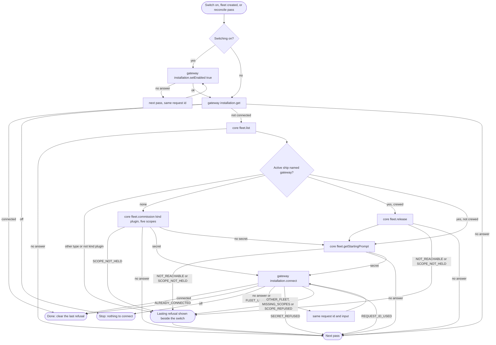
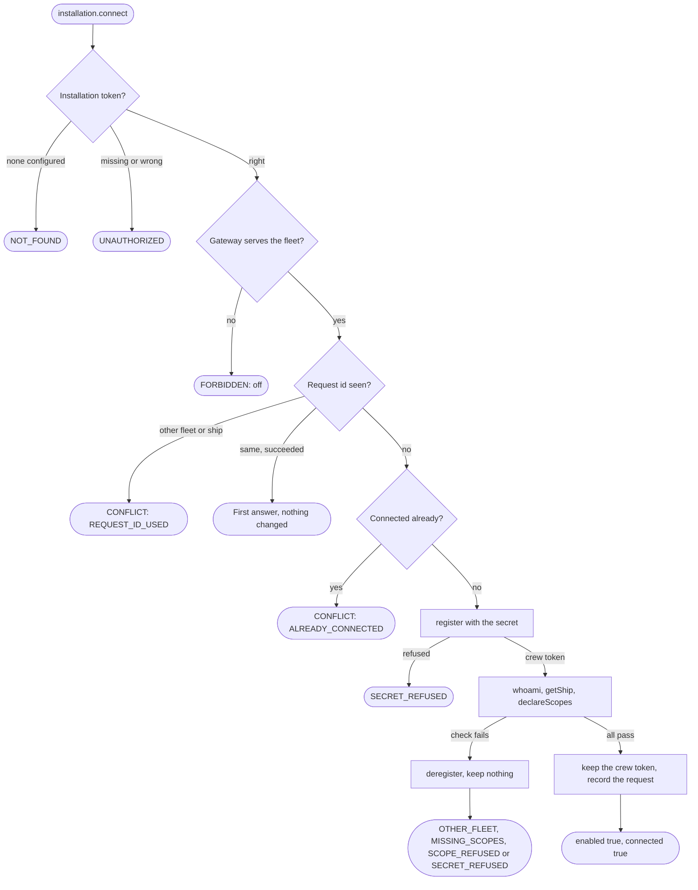

# The hosting service connects the gateway to a fleet

Design step for two of the account app's issues: 99 (switching the gateway on for a hosted fleet also connects it, Thomas, 21 Oct) and 193 (the gateway on by default for new hosted fleets). Purpose, the lessons to check against, the questions with their picks, then the detailed design. Thomas approved the purpose and all seven picks as written in section 3.

## 1. Purpose

**What must be true.** When the hosting service (the account app, acting as the installation) switches the gateway on for a hosted fleet, the gateway ends up connected to that fleet: its plugin ship commissioned in the fleet and crewed by the gateway, with no second step by anyone. For a new hosted fleet this happens at creation, because the gateway is on by default there (193).

**For whom.**
- A new user of a hosted fleet: their first agent's first question reaches them in Bridge or a connected chat, as the site's Quick start promises in step 4, without anyone pressing Connect gateway in the console.
- The app admin: one switch per fleet, not a switch here and a button in each fleet's console.
- A fleet manager: nothing to do. The console's Connect gateway stays for fleets no hosting service serves.

**Why it cannot happen today.** The gateway's installation procedures switch it on and off, read it and delete a fleet (`installation.setEnabled`, `get`, `delete`, `accountDisabled`), but none connects it. `connection.connect` takes the plugin ship's secret only from an actor holding fleet:manage in the fleet (`src/adapters/trpc/router.ts`, `managing(servedProcedure)`), and the installation token is no actor of the gateway's. Core can commission the gateway's ship through its own installation token, so the missing piece is the hand-over on the gateway's side.

**A good outcome.**
- After the account app's switch-on for a hosted fleet, the gateway's `installation.get` answers `connected: true`, or a refusal that names what to fix.
- A switch-on, or a connect, that fails halfway is finished by doing it again, never by a person.
- Switching the gateway off leaves the connection as it is (Thomas, 99); on again resumes.
- The gateway checks the hand-over exactly as it does today (the ship in that fleet, with the gateway's scopes, the gateway's scope declared) and keeps only the crew token, never the secret.

**Not in this purpose.** Outside parties: they stay a separate switch per fleet, off by default (0056, interop I-3), so the gateway on exposes only Bridge and the person connector. Disconnecting. The console's own Connect gateway. The account app's screens.

## 2. Lessons to check against

| Lesson | Source | Bearing |
| --- | --- | --- |
| Every call is authorised for an actor (a ship, an account, the installation) by scopes and reach, one catalogue and one check; in a fleet the installation acts through the same calls as any actor, with the scopes argo gives it there. What stays the installation's alone is above the fleet. | 0057 | The fleet side of connecting (commissioning the plugin ship) must be an ordinary core call the installation makes with scopes it holds in that fleet, not an installation-only bypass in core |
| Nothing is argo's alone: every argo job is a scope any actor can hold, fleet:connect among them. | 0053 | Connecting a plugin is not argo's alone; the installation may do it when it holds what it takes |
| A commission gives only scopes the granter holds. | 0046, 0053 | The installation must hold the gateway ship's scopes (fleet:read, fleet:commission, fleet:on-behalf, scopes:declare, fleet:verify) in the fleet to commission it |
| Every event names its actor; the installation's events carry the account and organisation admin who asked. | 0057 | The commission is recorded as the installation's, with the app admin in its details, never as a fleet manager who pressed nothing |
| argo is the fail-safe, never a normal path. | 0057 | No design where the account app connects by signing in as argo or routing through argo's console |
| A hosting service switches a plugin per fleet with that plugin's own installation token; off does nothing and keeps everything. | 0021 (squadrons), followed by the gateway | A hosted connect belongs beside `installation.setEnabled`, behind the gateway's installation token, with a request id |
| Installation procedures take request ids on create and delete; a replay answers its first answer. | 0020; `set-fleet-enabled.ts` | The hand-over is repeatable by the account app's reconcile |
| A plugin's commission is its connect; the console's server commissions the plugin ship (or reuses the last one, grants scopes it lacks, gives a new starting prompt) and hands the secret server to server. | core `connect-plugin.ts`, 0050 | The account app repeats that flow as the installation; the gateway's `createConnect` already checks the hand-over and stays the one check |
| "Connect" means connecting a plugin, nothing else. | 0050 | The new call connects the gateway's plugin ship; no new term |
| The gateway decides no reach of its own; policy stays in core. | gateway AGENTS.md, interop | The gateway does not judge whether the installation may connect a fleet: the secret core issued, and core's check of the commission, decide that |
| Before 1.0.0 no compatibility layers; keep designs minimal. | 0013 | No second connect path kept for old account app versions; no capacity machinery for zero customers |
| A switch for outside parties, off by default, warns on an open network. | 0056, I-3 | Gateway on by default does not open the fleet to outside parties; consent for that stays with fleet:network |

## 3. Questions and picks

Each pick below is approved. Section 4 onwards details them; section 9 names what core lacks for Q3.

### Q1. How does the gateway take the hand-over from the hosting service?

- (a) A new `installation.connect` procedure behind the gateway's installation token, taking a request id, the fleet id, the ship id and the secret, running the same `createConnect`. The account app calls it after it commissions the ship in core.
- (b) `installation.setEnabled` carries the ship id and secret when switching on, and connects in the same call.
- (c) `connection.connect` accepts the installation as an actor beside fleet:manage. The gateway would have to learn the installation's scopes in the fleet from core, which it has no credential for before it is connected.
- (d) The account app calls `connection.connect` with an account token of the fleet's fleet manager. Works today, but names an account that did nothing (0057) and fails for a fleet whose fleet manager has not signed in.

**Pick: (a).** It mirrors the installation procedures beside it (0021), keeps the switch and the connect apart, as Thomas's "off leaves the connection" needs, and leaves the fleet-side authority with core (0057).

### Q2. Who commissions the gateway's plugin ship in a hosted fleet?

- (a) The account app, as the installation, through core's commission, repeating what the console's `connectPlugin` does (reuse the last ship, grant scopes it lacks, new starting prompt).
- (b) The gateway, asking core with the installation's token. The gateway holds no core installation token, and should not.
- (c) Core, as a new installation procedure that commissions and hands over in one call. An installation-only path in a fleet, against 0057.

**Pick: (a).** Only the account app holds core's installation token; core needs no new call if the installation holds the scopes (Q3).

### Q3. How does the installation come to hold the gateway ship's scopes in a fleet?

- (a) The account app's fleet plan grants the installation, in every hosted fleet, the scopes the gateway's ship needs (fleet:read, fleet:commission, fleet:on-behalf, scopes:declare, fleet:verify), as it gives it the scopes its other jobs need (0020).
- (b) Core gives the installation every scope in every fleet. Wider than its jobs need.
- (c) A scope for connecting a plugin (fleet:connect, 0053) lets its holder commission a plugin ship with that plugin's listed scopes. Changes core's granting rule (0046).

**Pick: (a)**, to be checked against core: if the installation already holds them, nothing changes in core.

### Q4. What does a switch-on that fails halfway leave, and who finishes it?

- (a) The account app's reconcile repeats commission and connect until `installation.get` answers `connected: true`; a replayed request id answers its first answer; `ALREADY_CONNECTED` counts as done.
- (b) The gateway retries on its own. It cannot: it holds no credential until the hand-over succeeds.
- (c) A refusal is shown to the app admin and a person presses again.

**Pick: (a)**, with the last refusal shown to the app admin beside the switch, so a lasting one is visible.

### Q5. Which fleets does this reach (193's "what happens to existing fleets")?

- (a) Every hosted fleet with the gateway switched on and not connected, existing ones included, connected by the account app's reconcile; the default on applies to new fleets only.
- (b) New fleets only; existing fleets keep the console's button.
- (c) Every hosted fleet, switching the gateway on where it is off.

**Pick: (a).** It keeps Thomas's 99 decision for fleets switched on before it was built, and changes no fleet's switch.

### Q6. Does the gateway need a capacity limit before it is on by default (193)?

- (a) No limit now: zero customers, 0013 keeps it minimal; the fleet cap of 0020 already bounds the number of fleets.
- (b) A cap on fleets the gateway serves, in the gateway's configuration.

**Pick: (a)**, and raise it when real numbers show.

### Q7. Does the gateway on by default need consent (193)?

- (a) No: on by default serves only Bridge and the person connector to the fleet's own accounts; outside parties stay off until fleet:network turns them on with its warning (0056).
- (b) The account app asks the organisation admin at sign-up.

**Pick: (a).**

## 4. The contract: `installation.connect`

One new installation procedure beside `installation.setEnabled`, behind the gateway's installation token (`x-aeolus-installation-token`), as the others are: NOT_FOUND when the gateway has no installation token, UNAUTHORIZED when the token is missing or wrong.

**Input** (strict): `requestId` (an idempotency key), `fleetId`, `shipId`, `secret` (non-empty).

**Output**: `{ enabled: true, connected: true }`, as `installation.get` answers a connected fleet.

**What it does**, in order:

1. Refuses a fleet the gateway does not serve (switched off, or never switched on): FORBIDDEN, "The gateway is off for this fleet", as `connection.connect` does. The account app switches on first.
2. Looks up the request id. The request hash covers `connect`, the fleet id and the ship id, never the secret. The same id with another fleet or ship: CONFLICT, `REQUEST_ID_USED`. The same id after a success: the first answer, with nothing changed and no call to the fleet.
3. Runs the gateway's existing `createConnect` with the fleet id as the fleet the ship must belong to. Every check stays as it is: the secret registers, `whoami` names this fleet, the ship holds the gateway's five scopes, the fleet takes the declared `gateway` namespace. On a refusal the gateway lets the ship go and keeps nothing.
4. On success, records the request (kind `connect`) and answers. A refusal records nothing, so the same request id may be tried again.

**Refusals**, mapped as `connection.connect` maps them (`CONNECT_CODES`), plus the two above:

| Kind | Code | The account app's reading |
| --- | --- | --- |
| off | FORBIDDEN | Switched off meanwhile: nothing to do until on again |
| `REQUEST_ID_USED` | CONFLICT | Its own defect: a new request id |
| `ALREADY_CONNECTED` | CONFLICT | Done |
| `SECRET_REFUSED` | BAD_REQUEST | Try again from a new starting prompt |
| `OTHER_FLEET` | BAD_REQUEST | Lasting: shown to the app admin |
| `MISSING_SCOPES` | BAD_REQUEST | Lasting: shown to the app admin |
| `SCOPE_REFUSED` | CONFLICT | Lasting: shown to the app admin (another ship declared `gateway`) |
| `FLEET_UNAVAILABLE` | BAD_GATEWAY | Try again with the same request id |

The secret is never kept, logged or hashed. The gateway keeps only the crew token, as today.

**Gateway parts touched**: the router's installation procedure; a use case `createInstallationConnect` in `src/core/installation` that takes the request store, the served check and `Connect`; the `connect` kind in `InstallationRequest` and its Prisma adapter (`installation-requests.ts`, the kind's schema). No new table.

## 5. The account app's side

The account app does this as the installation, through core's fleet calls, with core's installation token and the `Aeolus-Fleet` header naming the fleet (0057). It repeats what the console's `connectPlugin` does for a plugin that is not connected, without the scope grant (section 6).

**When.** On switching the gateway on for a fleet, at fleet creation (on by default, 193), and in its reconcile, for every hosted fleet with the gateway on and not connected (Q5). Never for a fleet with the gateway off.

**One pass for a fleet:**

1. `installation.setEnabled` on the gateway with `enabled: true`, when switching on. Its own request id, as today.
2. `installation.get` on the gateway. `connected: true`: done. `enabled: false`: stop.
3. Core `fleet.list`: the fleet's ships. Takes the active ship named `gateway`.
   - Of another type than `gateway`, or not of kind plugin: lasting refusal, shown to the app admin ("A ship named gateway of another type exists: rename or retire it").
4. With such a ship: core `fleet.release` when it is crewed (its session is gone, since the gateway holds no token for it), then core `fleet.getStartingPrompt`: the secret.
5. Without one: core `fleet.commission` with name `gateway`, type `gateway`, kind `plugin`, scopes `fleet:read`, `fleet:commission`, `fleet:on-behalf`, `scopes:declare`, `fleet:verify`, and an idempotency key of its own, the same one when the call is tried again after no answer. The secret is in the answer, or comes from `fleet.getStartingPrompt` when it is null.
6. The gateway's `installation.connect` with a new request id, the fleet id, the ship id and the secret. A lost answer is tried again with the same request id and input.
7. Reads the outcome as the table in section 4 says. A lasting refusal is kept and shown beside the fleet's gateway switch; a pass that ends connected clears it.

The secret lives only in the one pass that carries it, server to server, never in the account app's database or logs.

Every core event of the pass names the installation as its actor, with the account and the organisation admin who switched the gateway on (or created the fleet) in its details. A reconcile pass carries the same admin, kept with the switch.

**Switching off** calls only `installation.setEnabled` with `enabled: false`. The connection and the gateway's ship stay; on again resumes, and the reconcile finds it `connected: true` and does nothing.

## 6. Core calls used and scopes

| Call | Scope core checks | Reach |
| --- | --- | --- |
| `fleet.list` | `fleet:read` | read |
| `fleet.commission`, kind plugin | `fleet:connect`, and every scope granted held by the granter (0046) | none |
| `fleet.getStartingPrompt` | `fleet:manage` | manage, on the gateway's ship |
| `fleet.release` | `fleet:manage` | manage, on the gateway's ship |

The installation must hold in every hosted fleet: `fleet:read`, `fleet:manage`, `fleet:connect`, `fleet:commission`, `fleet:on-behalf`, `scopes:declare`, `fleet:verify`. No `scopes:grant`: the hosted flow commissions the gateway's ship with the five scopes and never grants scopes to an existing one. A ship that lacks one (commissioned elsewhere) ends in `MISSING_SCOPES`, shown to the app admin, who fixes it in the console.

The gateway's side needs no scope: the secret core issued, and core's checks of the commission, decide that the installation may connect the fleet.

## 7. Flow

Inside `installation.connect`:

## 8. Test scenarios

Gateway, use case `createInstallationConnect` with in-memory ports:

- Connects a served fleet with a good hand-over: the crew token kept, `connected: true` answered, the request recorded.
- Refuses a fleet the gateway does not serve, asking the fleet nothing and recording nothing.
- A replayed request id after a success answers its first answer and asks the fleet nothing.
- A request id used for another fleet or ship answers `REQUEST_ID_USED`.
- A refused request records nothing: the same request id connects on a later try.
- Every `createConnect` refusal comes through unchanged (`ALREADY_CONNECTED`, `SECRET_REFUSED`, `OTHER_FLEET`, `MISSING_SCOPES`, `SCOPE_REFUSED`, `FLEET_UNAVAILABLE`), keeping nothing; `createConnect`'s own tests stay its proof.
- The secret is in no recorded request and no request hash.

Gateway, router:

- `installation.connect` is NOT_FOUND without an installation token configured, UNAUTHORIZED with a wrong one, and maps each refusal to its code in section 4.
- Off, then on again after a connect: `installation.get` answers `connected: true` without a second connect.

Gateway, Postgres (Testcontainers):

- A `connect` request is stored and found by its request id, scoped by fleet.
- Two connects of one fleet at once, with one secret: one connection kept, the other refused, no second crew token kept.

The account app (its own tests, named here as behaviour):

- A new hosted fleet ends with `installation.get` answering `connected: true`, with no step by anyone.
- Switching on an existing fleet that is not connected connects it; one switched off is not touched.
- A pass that stops after commission (no answer from the gateway) is finished by the next pass, which reuses the ship with a new starting prompt.
- A crewed `gateway` ship the gateway holds no token for is released and connected again.
- A ship named `gateway` of another type, or a lasting refusal, is shown beside the switch and cleared by a pass that ends connected.
- A lost `installation.connect` answer, tried again with the same request id, answers connected.
- Switching off keeps the connection; on again leaves it connected.
- No secret in the account app's database or logs.

Core (if section 9 lands there): the installation commissions a plugin ship with the gateway's five scopes, and gets a starting prompt for and releases the ship it commissioned.

## 9. What core lacks

Checked against core's main: the installation holds the same scopes in every fleet (`INSTALLATION_SCOPES`: `fleet:read`, `fleet:manage`, `labels:define`, `labels:assign`, `fleet:person`, `labels:any`), and no call lets argo or the account app change them. Q3's pick, the account app's fleet plan granting them, has no core call to use. The hosted flow needs, in core:

- `fleet:connect`, `fleet:commission`, `fleet:on-behalf`, `scopes:declare` and `fleet:verify` added to the installation's scopes, so it may commission the gateway's plugin ship with its five scopes.
- Manage reach on the gateway's ship for `fleet.getStartingPrompt` and `fleet.release`: the installation's built-in manage rule reaches person ships and what they own, not a plugin ship. Without it, a pass that stops after the commission cannot be finished by the next one.

Both are open with orchestrator-1; this design assumes them.
