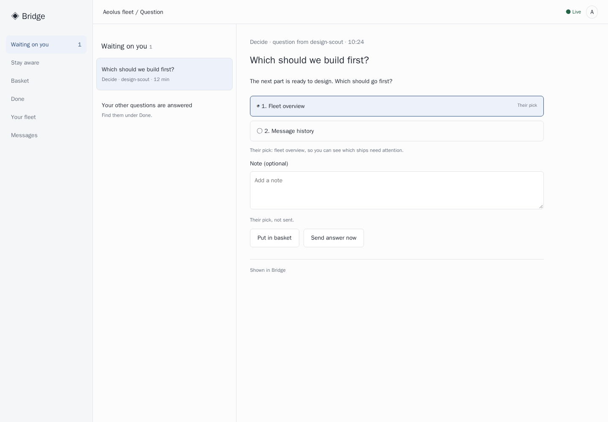
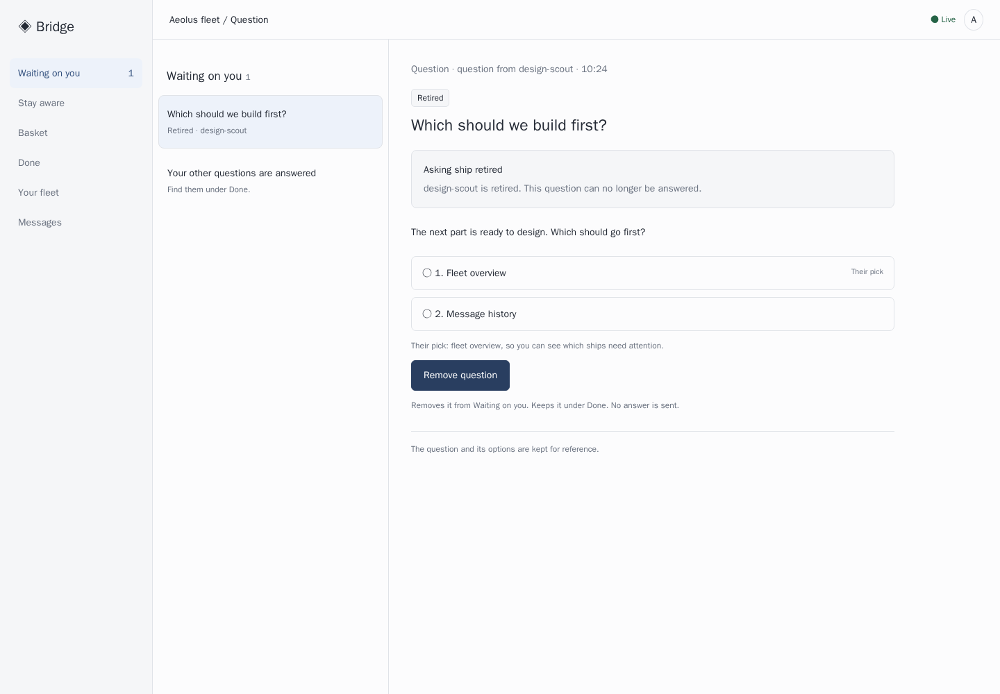
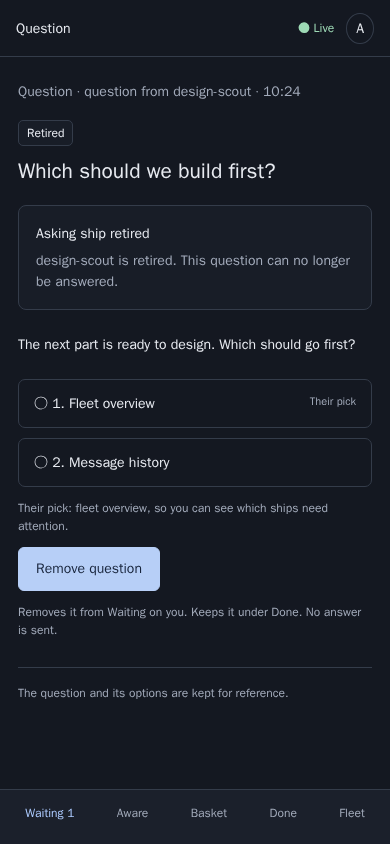
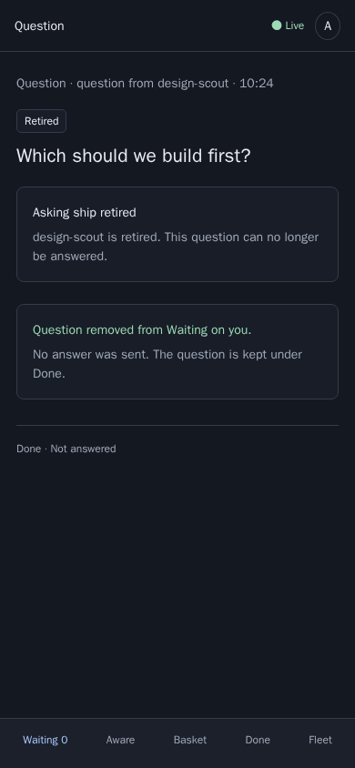

# A question whose asking ship is retired

Proposed Bridge mockups for [#255](https://github.com/ThomasHendrickx/aeolus-fleet-gateway/issues/255), awaiting Thomas's approval.

## Purpose

Before a person writes an answer, show that the asking ship is retired and cannot receive it. Let the person remove the question from Waiting on you without sending an answer. Keep the question under Done, not answered.

Use the existing Bridge shell, split view on desktop, focused question on phone, and light and dark colours. Retirement is a quiet ended state, with words as well as colour. Keep the context, options and the ship's pick for reference, with no answer controls or note field. Do not select an option as the person's answer.

## What core tells the person today

[#226](https://github.com/ThomasHendrickx/aeolus-fleet-gateway/issues/226) and [PR #252](https://github.com/ThomasHendrickx/aeolus-fleet-gateway/pull/252) clear an old question after an attempted answer is refused because the asking ship is retired. That is too late to save the person writing an answer.

Core [#1632](https://github.com/ThomasHendrickx/aeolus-fleet/issues/1632), delivered by [PR #1825](https://github.com/ThomasHendrickx/aeolus-fleet/pull/1825), withdraws open questions when their asking ship retires. The question becomes withdrawn and cannot be answered. A release withdraws nothing: a released ship can receive the answer when its next crew arrives. An already answered question stays answered.

**Core 0.40.0 is the first released version containing this change.** The retirement change is [included in 0.40.0](https://github.com/ThomasHendrickx/aeolus-fleet/compare/6438dabd22c80514e30394d176a194fa45d4592d...v0.40.0), but [not in 0.39.1](https://github.com/ThomasHendrickx/aeolus-fleet/compare/v0.39.1...6438dabd22c80514e30394d176a194fa45d4592d). [0.40.0 was released on 15 November](https://github.com/ThomasHendrickx/aeolus-fleet/releases/tag/v0.40.0).

This is an ordinary withdrawal. It does **not** tell Bridge that retirement caused it. Through the current released core 0.43.0, this withdrawal alone supports “Question withdrawn”, not “Asking ship retired”. Bridge must not infer retirement from a withdrawal or an unsuccessful search for the ship.

**The retirement-specific proposal needs a future core release that authoritatively tells the person's ship that the asker is retired. No version has been assigned for that addition.** Core 0.40.0 is enough for automatic withdrawal, but is not enough for the retirement-specific words on these sheets. The proposed checking state is a person-facing state, not a choice of how core supplies that fact.

Core does not revisit ships already retired before this change. Its migration also cannot find older sealed questions. Those old questions need the retirement fact before Bridge can offer the proposed removal. Do not promise an upgrade clears all old questions. A withdrawal received before the person sees a question follows Bridge's existing rule: it never appears as waiting. The mockups cover an old question still waiting, or a question already open when its asking ship retires.

## Lessons to keep

- A retired ship is never addressed again. Remove sends no answer.
- Marking a question done does not answer it. Done must say “Not answered”.
- A withdrawal alone is not evidence of retirement.
- A person can see every action working and knows whether it succeeded.
- Retirement learned while an answer is being written removes the send controls. Keep the unsent note visible for copying and say “Your answer was not sent.” An answer the fleet accepted before retirement stays answered.

## Proposed words and behaviour

| State | Words | What the person can do |
| --- | --- | --- |
| Checking | “Checking the asking ship…” / “Wait while Bridge checks whether this question can still be answered.” | See a spinner. No answer controls while the fact is being checked. |
| Check failed | “The asking ship could not be checked” / “Bridge could not check whether design-scout can receive an answer. Try again before answering.” | “Try again” shows Checking immediately, then the result or the same failure. |
| Withdrawal only | “Withdrawn” / “Question withdrawn” / “Nothing to answer: it is done.” | Read it. No retirement claim or answer controls. |
| Retired, before writing | “Retired” / “Asking ship retired” / “design-scout is retired. This question can no longer be answered.” | “Remove question”. |
| Removal explanation | “Removes it from Waiting on you. Keeps it under Done. No answer is sent.” | Remove in one action, no confirmation. |
| Removing | “Removing…” | Spinner, disabled removal button. Keep the question visible until success. |
| Removed | “Question removed from Waiting on you.” / “No answer was sent. The question is kept under Done.” | Read the retained question. Waiting count decreases only after success. No automatic move to another question. |
| Removal failed | “The question could not be removed. Try again.” | “Try removing again” returns to Removing. Keep the question and count. |
| Done | “Done · Not answered” | Read the question under Done. |

The removal is from Waiting on you, not deletion of the message. There is no new withdrawal sent on the person's behalf. If the question has an unsent answer in the basket, remove that entry with the question and say “The unsent answer was removed from the basket.” Never send it to a retired ship. Preserve an unsent note for copying if removal fails.

## Screenshots

The before sheet reconstructs the still-open question from the earlier report: an answer can be composed and no retired state is shown. The separate withdrawal sheet shows what the released core can tell Bridge today. The after sheet proposes the retirement-specific state, dependent on the future core signal above. All names and question text are illustrative.

| State | Desktop light | Desktop dark | Phone light | Phone dark |
| --- | --- | --- | --- | --- |
| Before: old question | [desktop light](screenshots/before-desktop-light.png) | [desktop dark](screenshots/before-desktop-dark.png) | [phone light](screenshots/before-phone-light.png) | [phone dark](screenshots/before-phone-dark.png) |
| Released core: withdrawn | [desktop light](screenshots/withdrawn-desktop-light.png) | [desktop dark](screenshots/withdrawn-desktop-dark.png) | [phone light](screenshots/withdrawn-phone-light.png) | [phone dark](screenshots/withdrawn-phone-dark.png) |
| Proposed: retired | [desktop light](screenshots/after-desktop-light.png) | [desktop dark](screenshots/after-desktop-dark.png) | [phone light](screenshots/after-phone-light.png) | [phone dark](screenshots/after-phone-dark.png) |
| Checking | [desktop light](screenshots/checking-desktop-light.png) | [desktop dark](screenshots/checking-desktop-dark.png) | [phone light](screenshots/checking-phone-light.png) | [phone dark](screenshots/checking-phone-dark.png) |
| Check failed | [desktop light](screenshots/unknown-desktop-light.png) | [desktop dark](screenshots/unknown-desktop-dark.png) | [phone light](screenshots/unknown-phone-light.png) | [phone dark](screenshots/unknown-phone-dark.png) |
| Removing | [desktop light](screenshots/removing-desktop-light.png) | [desktop dark](screenshots/removing-desktop-dark.png) | [phone light](screenshots/removing-phone-light.png) | [phone dark](screenshots/removing-phone-dark.png) |
| Removed | [desktop light](screenshots/removed-desktop-light.png) | [desktop dark](screenshots/removed-desktop-dark.png) | [phone light](screenshots/removed-phone-light.png) | [phone dark](screenshots/removed-phone-dark.png) |
| Removal failed | [desktop light](screenshots/error-desktop-light.png) | [desktop dark](screenshots/error-desktop-dark.png) | [phone light](screenshots/error-phone-light.png) | [phone dark](screenshots/error-phone-dark.png) |

### Before

### Proposed

## Walk the mockups

Open [the local mockup](mockup.html). It starts with the proposed retired question. This is a design simulation, with no fleet connection.

1. Read the retired notice before any answer field. There is no field to write an answer.
2. Choose Remove question. It says Removing with a spinner, then confirms removal, shows Done · Not answered and changes Waiting from 1 to 0.
3. Open `mockup.html?fail=1`. Choose Remove question. After Removing, the question remains, with the failure and Try removing again.
4. Open `mockup.html?state=unknown`. Choose Try again. Checking appears, then the simulated retired result.
5. Add `&theme=dark` to any query to view dark colours. Use a 390 px phone or a 1440 px desktop viewport.

For direct comparison, use `?state=before`, `?state=withdrawn`, `?state=after`, `?state=checking`, `?state=unknown`, `?state=removing`, `?state=removed` or `?state=error`.
