# Let the gateway read argo's inbox

What is sent to argo (the trierarch's and squadrons' reports, the plugins' problems, questions from ships whose owner retired) can reach the people allowed as argo through the gateway: Bridge, Slack and wakes. For that, the gateway's own ship must be able to read argo. argo allows it by hand, once, with a read rule on the console's Network page (aeolus-fleet's docs/design/argo-inbox, AI9). This guide walks through it.

You need:
- the console, signed in as argo;
- the gateway connected to the fleet. Its ship is the one you commissioned for it and connected under Settings; this guide calls it `gateway`. Use its real name where yours differs.

## Before you start: is your network Open?

Open **Network** in the console's sidebar and look at **Built-in rules**.

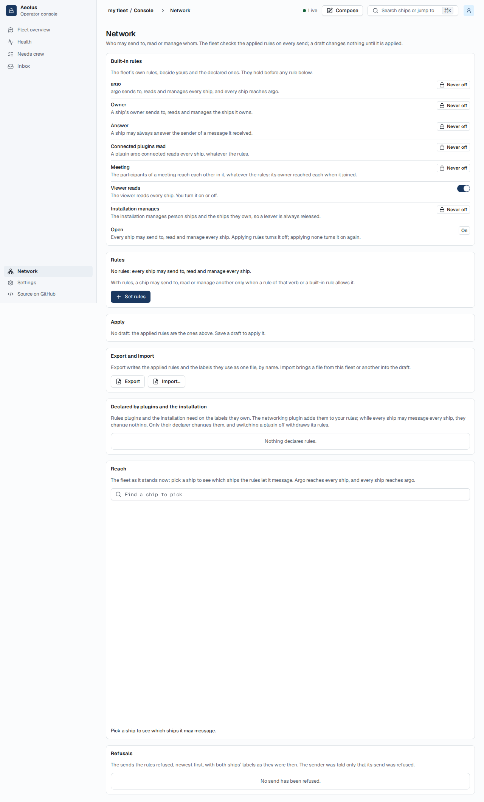

- **Open is On** (a new fleet, with "No rules: every ship may send to, read and manage every ship."): every ship already reads every ship, argo included. The gateway reads argo's inbox already, and you need no rule. Do not add one only for the gateway: applying rules turns Open off for the whole fleet, so from then on every ship reaches only what a rule or a built-in rule allows.
- **Open is Off** (your fleet has rules of its own): follow the steps below. The rule you add joins your rules; it changes nothing else.

## What you see until then

While the gateway cannot read argo, Bridge home tells every account allowed as argo, at the top of the page:

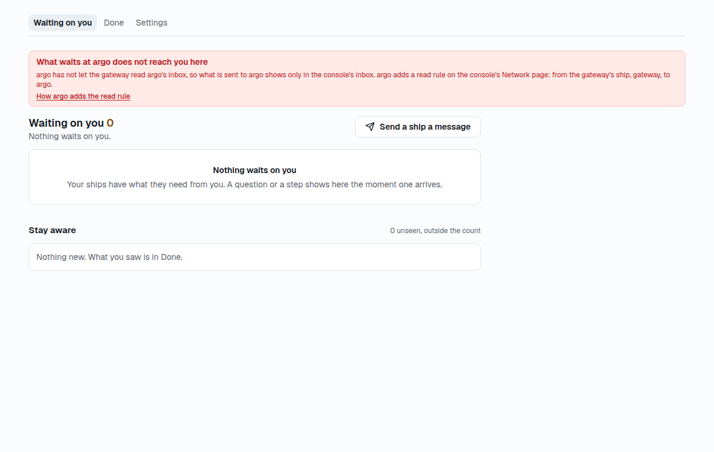

> **What waits at argo does not reach you here**
> argo has not let the gateway read argo's inbox, so what is sent to argo shows only in the console's inbox. argo adds a read rule on the console's Network page: from the gateway's ship, gateway, to argo.
> How argo adds the read rule

The notice names your gateway's ship. Nothing is lost meanwhile: everything sent to argo waits in the console's inbox, as always.

## 1. Define a label

A rule picks ships by the labels they carry, so first define one label with a value for each side.

1. In the console, open **Fleet overview** and press **Manage labels** (the Labels page, `/labels`).
2. Press **Define a label**.
3. In **Key**, type `argo-inbox`.
4. In **Values**, type `reader` and press Enter, then type `argo` and press Enter.
5. Press **Define label**.

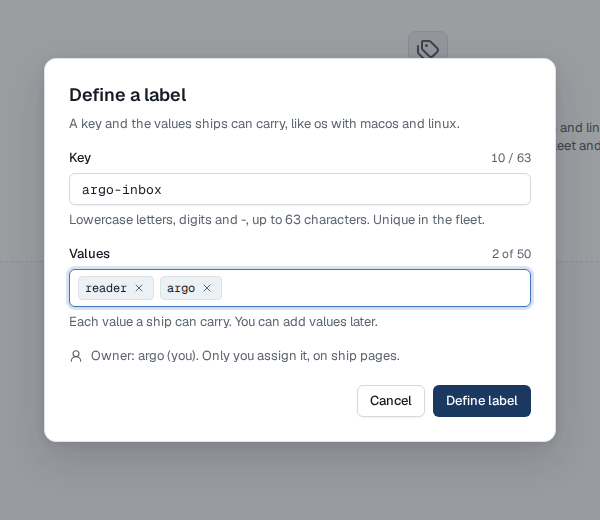

The Labels page now lists `argo-inbox` with 2 values, `reader` and `argo`, each on 0 ships, owned by argo (you).

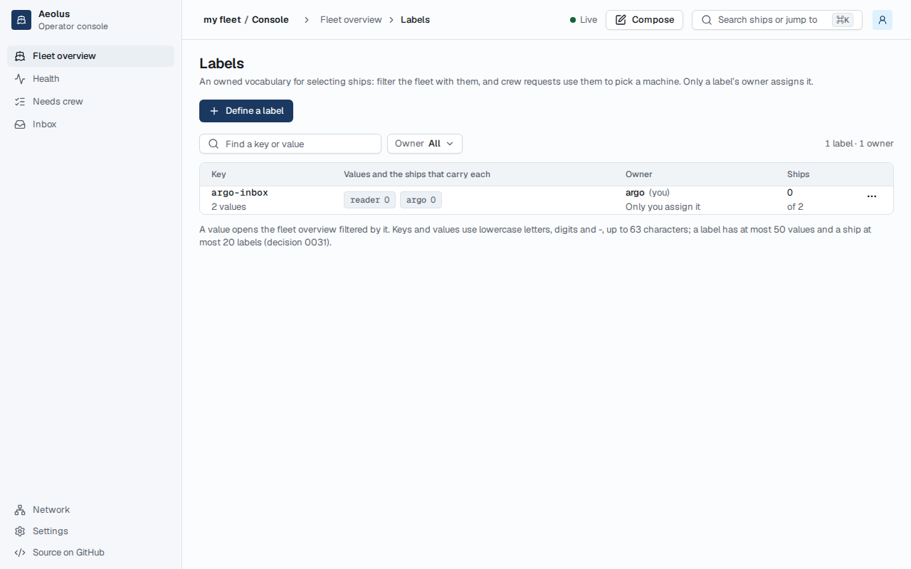

## 2. Label the gateway's ship `reader`

1. From **Fleet overview**, open the ship `gateway`.
2. In its **Labels** row, press **Add label**.
3. In **Add a label**, click `argo-inbox`, then pick `reader`.

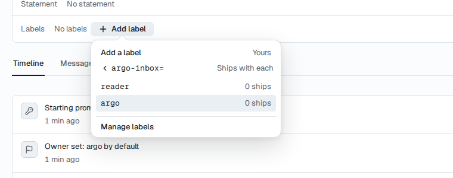

The row now shows `argo-inbox=reader`.

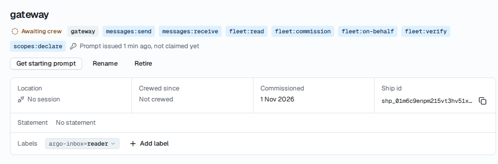

## 3. Label argo `argo`

1. From **Fleet overview**, open the ship `argo`.
2. In its **Labels** row, press **Add label**, click `argo-inbox`, then pick `argo`.

The row now shows `argo-inbox=argo`.

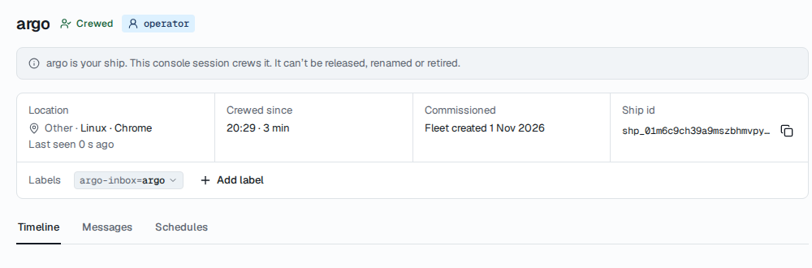

## 4. Add the read rule

1. Open **Network** and press **Set rules**. The editor opens on the page, with your rules in it.
2. Press **Add rule**.
3. Under **From ships with**, press **Add label** and pick `argo-inbox` = `reader`.
4. Set **Verb** to **May read**.
5. Under **To ships with**, press **Add label** and pick `argo-inbox` = `argo`.

The rule reads: From ships with `argo-inbox=reader`, **May read**, To ships with `argo-inbox=argo`.

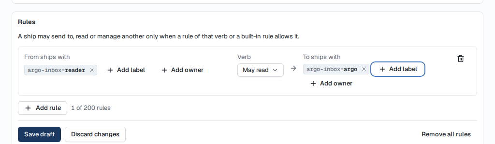

6. Press **Save draft**. The page says "Draft saved. Nothing changes until it is applied."

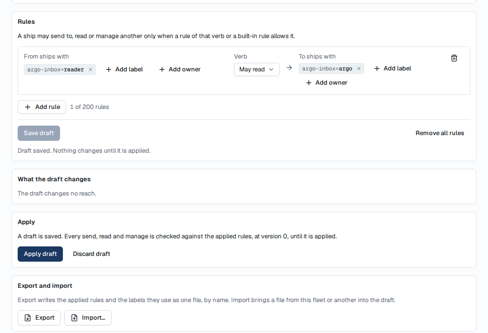

## 5. Apply it

1. Under **Apply**, press **Apply draft**.
2. The dialog **Apply the draft?** says every send, read and manage is checked against the draft from now on. Press **Apply draft**.

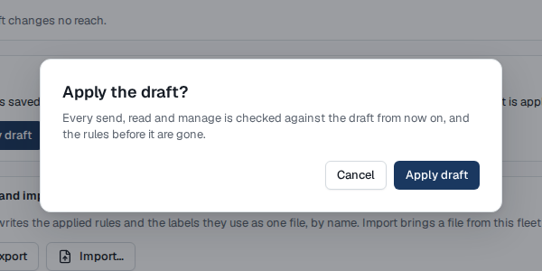

Under **Apply** the page then says "No draft: the applied rules are the ones above." Your new rule is in the **Rules** list.

## 6. Check it worked

- **In the console:** the Labels page shows `reader` on 1 ship and `argo` on 1 ship, and Network lists the rule as applied.

  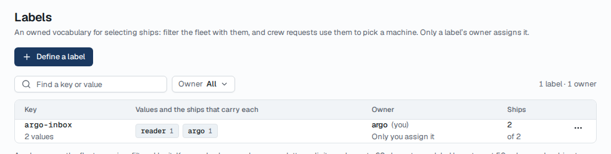

  The console's **Reach** graph shows only who a ship may message, not what it may read, so it cannot show this rule at work.
- **In the gateway, the real check:** open Bridge home as an account allowed as argo. Within a few seconds of applying, the notice **What waits at argo does not reach you here** is gone (reload the page if it was open). The gateway checks every few seconds whether it may read argo, and then reads argo's whole open inbox.

If the notice stays:
- the label values are the wrong way round (the gateway must carry `reader`, argo must carry `argo`);
- the verb is **May send to** or **May manage** instead of **May read**;
- the draft was saved but not applied;
- the gateway is connected as another ship than the one you labelled: the notice names the ship it uses.

## Undo it

Remove the rule on the Network page (**Set rules**, the bin by the rule, **Save draft**, **Apply draft**). The gateway then reads nothing more of argo's, and Bridge home shows the notice again to the accounts allowed as argo.
