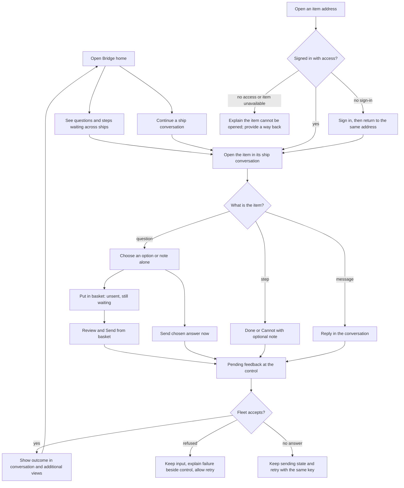

# Bridge's pages and navigation

Design for [#266](https://github.com/ThomasHendrickx/aeolus-fleet-gateway/issues/266), including [#260](https://github.com/ThomasHendrickx/aeolus-fleet-gateway/issues/260), under the [approved Bridge app purpose and order](../README.md). Thomas approved the purpose, detailed design and [before/after sheets](mockups/README.md), with the user-facing naming requirement below. They are the acceptance criteria for the build.

## User-facing name

Show **Aeolus** in the interface. Bridge remains the name used to identify this part of the gateway in code and design references. Thomas: "One thing: We dont show Bridge, we show Aeolus. No need to redo the mockups to change this." The approved sheets retain their existing labels; this naming requirement takes precedence in the build.

## Purpose

Make the existing working Bridge easy for a person to understand and use on phone and desktop. A person sees what needs them, opens it with context, answers or completes it, returns to the same item and reads back the outcome, without losing their place.

Navigation makes the current place and the way back clear. Questions and actions remain distinguishable from information, including with 20 questions/actions and 20 messages. Resolve each of #260's seven differences explicitly against the actual build and the approved sheets.

This part establishes how the person works across conversations and additional views of the same items, before choosing pages or navigation. The app parts are design and build responsibilities, not separate screens. Installation and notifications remain their own parts. The approved basket, optional notes and shared-record rules stand unless explicitly changed.

## Lessons to check against

The [app design's lessons](../README.md#2-lessons-to-check-against) apply: the actual build is the before, not a reconstruction from the kit; every #260 difference needs a disposition; page refreshes and live changes must preserve the open item's address (#282); working functionality alone does not establish a usable path.

## Look and feel

Use [Thomas's reference](../reference/look-and-feel.jpg) for the warm light ground, navy primary, soft cards, spacing and the question card inline in a conversation.

Thomas: "I have a potential nice visual of the bridge setup. The names and icons and so on dont fit, but look and feel really work for me".

Use Aeolus's language, icons following the [Aeolus design system](https://github.com/ThomasHendrickx/aeolus-fleet/blob/main/docs/design/README.md), and the real mark from [aeolus-fleet brand/](https://github.com/ThomasHendrickx/aeolus-fleet/tree/main/brand). The reference's names, icons and logo are not the design. Its layout follows the approved design below; its Submit decision button does not replace the existing choice of direct send and the basket. [#202](https://github.com/ThomasHendrickx/aeolus-fleet-gateway/issues/202) records Thomas's later approval of direct send beside putting an answer in the basket; that current behaviour stands.

## Interaction, approved

Thomas chose conversations with additional views of the same items (option 1).

A ship discusses a design, asks a question, reports progress and asks the person to take a step. Those items can remain together in the conversation. The same unanswered question can also appear in a view of everything needing the person across conversations. Answering in either place is one answer on the same item. An alert can appear in its conversation and an awareness view.

This preserves the context of the exchange while keeping an ask from disappearing in a busy chat. Message type does not dictate a separate screen. A flow means following related discussion, questions, steps and outcomes together, without prescribed stages or an automatic next step (Thomas, option 1). There is one conversation with each ship: all direct exchanges together, with reply links back to the item being answered (Thomas, option 1). Bridge opens on a home overview of what needs the person and conversations to continue. An item opens in its ship conversation with surrounding context and a way back; the conversation list is directly reachable (Thomas, option 1). The layout and navigation below are approved, subject to the Aeolus naming requirement.

## Questions

### 1. How do conversations and what needs the person fit together?

**Answered: option 1, approved by Thomas.**

1. **Conversations with additional views of the same items.** Questions, steps, messages and alerts can appear in their conversation and be found in additional views, with one state and one answer. Explore related work before choosing screens.
2. **One chat experience without additional attention views.** Find outstanding work within the conversation experience.
3. **Start from a flow of related work.** Explore discussion, decisions and actions as a piece of work first, then place chats and other views.
4. **None of these.** Describe the intended interaction.

**Pick: 1.** Keep the context and make outstanding asks findable without making message type dictate a separate screen.

### 2. What should the person follow in a flow?

**Answered: option 1, approved by Thomas.**

Context: discuss a proposed change, choose a design, take a human-only step, then review what was produced. Does flow mean seeing that related context together, or explicit progress and what comes next? Current questions and steps alone establish no new work process.

1. **Related discussion, questions, steps and outcomes together.** Understand the course of the work and return to its context, without prescribed stages or an automatic next step.
2. **Progress through explicit stages of work.** See where work stands and what comes next, alongside conversations and decisions. Stages and who controls them need their own design.
3. **Keep flows for later.** Design conversations and additional views first.
4. **None of these.** Describe the intended flow, preferably with an example.

**Pick: 1.** Make a question and its outcome understandable in context without assuming a staged process Thomas has not described.

### 3. What makes one conversation?

**Answered: option 1, approved by Thomas.**

Context: the same ship may discuss the Bridge design and an unrelated release. Grouping by ship is familiar but mixes subjects; grouping by work requires explicitly assigning each item rather than guessing from its text. Meetings already have their own identity and remain their own design part.

1. **One conversation with each ship.** All direct exchanges together; reply links lead back to the item being answered. Additional views expose what needs the person across chats.
2. **Separate conversations by subject or piece of work.** A ship can have several conversations with the person. Each item explicitly belongs to one; who starts and names it remains to design.
3. **A chat with each ship, with separate discussions inside it.** The ship remains the place to go; a related discussion can also be followed on its own.
4. **None of these.** Describe what the person expects to open and follow together.

**Pick: 1.** A familiar starting point without assigning a subject to every item; explicit reply links keep related context reachable. If following one piece of work separately is essential, option 2 or 3 fits better.

### 4. What should Bridge show when opened?

**Answered: option 1, approved by Thomas.**

Context: the agreed conversation model can support either an overview first or the conversation list first. The visual reference suggests an overview leading into conversations, but its layout is not approved. Direct item addresses still open the addressed item; the basket remains.

1. **Home with what needs the person and conversations to continue.** Questions and steps needing the person across conversations, awareness distinct from that count, and recent conversations. An item opens in its ship's conversation with surrounding context and a way back. The conversation list is directly reachable too.
2. **The conversation list first.** Chats with ships, each showing what needs the person; the overview remains reachable.
3. **None of these.** Describe a different starting point or movement between them.

**Pick: 1.** Know where the person is needed across a busy fleet, and act in conversation context.

## Detailed design, approved

Thomas approved this section and the sheets shown at commit `0f9b5f74` (final approval question, option 1), with Aeolus as the user-facing name. The agreed purpose and interaction above remain the foundation.

### The parts the person uses

| Part | Purpose and proposed presentation |
| --- | --- |
| Home | A warm, quiet overview. A navy card leads with the count of unanswered questions and unfinished steps, split by kind. Awareness is outside that count. Below it, waiting items lead to their place in conversation; recent conversations let the person continue work. Your fleet remains reachable and visible on larger windows |
| Conversations | One exchange per ship, both directions in time order. Questions and steps are cards within that exchange, not detached mail. Replies link to what they answer. A ship name stays the concrete name core gives it |
| An item in conversation | Open the addressed item, load its surrounding context, and bring it into view without losing its address. The item retains one state wherever it appears. Reading context must not silently acknowledge every other item in the conversation |
| Waiting on you | An additional view across conversations, not another copy. Its questions and steps stay until answered or completed, or withdrawn as already agreed. Each opens its item in conversation context |
| Stay aware | Alerts and notices together, outside the waiting count, with a route to their conversation and the current ship state where appropriate. Existing seen/outcome rules stand |
| Basket | Pending answers collected across conversations; its count and unsent state stay visible. Change, Remove and Send keep today's meaning. An inline question offers direct Send as well, as Thomas approved in #202 |
| Done | A readable record of outcomes, sender, time and where the person acted. Open one to read it with context. Compact rows keep the important outcome visible without explanatory boilerplate on every card |
| Your fleet | The existing Harbour presentation, reachable from home and navigation. Use shared state meanings and parts rather than redrawing them as a new set of status cards |
| Settings and argo | One consistent shell around Bridge and gateway settings. Account links say when they leave for another app. argo appears only for an account allowed as argo, clearly apart from the person's own questions; its actions keep their current destinations |

### Navigation and widths

Desktop has a labelled sidebar and a main area that uses the available width. Home distributes its waiting items, conversations/awareness and fleet across that width. A conversation has the ship list beside it and a bounded reading column; surrounding space is navigation or context rather than stretched prose. The sidebar reduces to a rail on intermediate widths.

Phone uses Home, Conversations, Fleet and More as the approved four-tab layout. This follows the agreed interaction; the earlier Waiting/Messages layout is not the design. More contains Stay aware, Done and Settings, plus argo only when allowed. The basket appears above tabs while unsent. A conversation has one header, Back to the originating view, its ship name and the exchange; the tab bar gives way to the reply composer. A question has no second page header inside that conversation.

Meetings remains a separate view under #279. Its eventual navigation position needs its own approval. The mockups show no inactive Meetings tab. Chats are being placed in the app structure here; #287 retains responsibility for their data reads and message behaviour. The approved order of implementation is unchanged by a picture of the intended conversation.

### What happens when the person acts

- A live page re-read, refresh or reopening the address preserves the addressed item (#282). Arrivals update the relevant rows and counts; they do not move the person's reading position.
- An answer in Slack or another chat appears as the same outcome. A later action here does not send a second answer. An answer in the basket is removed when answered elsewhere.
- Withdrawal removes actions immediately; the overview follows its existing five-second rule. An already-open withdrawn item remains read-only until the person leaves; a replacement links to its new question or step.
- A step's Done and Cannot send its optional note at once. The note field is visible before either action. A link names its outside host.
- Sending shows a working label/spinner and disables repeat presses immediately. Success persists as an outcome; refusal preserves the option and note with an inline reason. An unconfirmed send retries under the same key.
- Loading preserves chrome and uses content-shaped skeletons. An empty home says nothing waits while conversations and outcomes remain reachable. A failed record read gives a reason and retry. A failed fleet read leaves questions usable and marks only that part unavailable.

### The seven #260 dispositions, approved

| # | Approved disposition | Why |
| --- | --- | --- |
| 1 | Show the real Aeolus mark with the Aeolus name, retain an explicit app/fleet switch, and mark Fleets and account as opening the Account app | Bridge is recognisable without losing the existing app and fleet choices. Current code already draws the outward arrow; the old issue describes an earlier build |
| 2 | Do not introduce global content search in this slice. Offer finding a ship within Conversations; content search is tracked in [#246, Bridge: tabs and search](https://github.com/ThomasHendrickx/aeolus-fleet-gateway/issues/246) | The old kit's search box has no agreed behaviour. A decorative search field would promise a capability not yet designed |
| 3 | Use compact Done rows with sender, outcome, where acted and time. Drop repeated “Opening one reads it back whole.”; retain access to the whole item and places where they matter | Scanning outcomes is easier without losing the record or the ability to open it |
| 4 | Four phone tabs: Home, Conversations, Fleet, More. Done and awareness under More; argo only when allowed. Basket visible while unsent | Conversation and attention remain distinct views of the same items, without a tab per message type |
| 5 | Move the phone home Send action into Conversations as “Message a ship”. Keep sending a new message available on both widths | The action belongs with exchanges, rather than becoming a second action competing with what waits on home |
| 6 | Retain one phone navigation header when the item moves into its conversation: Back and the ship name. The current captured build already has one navigation header; the older issue describes a different state. The inline question has its own title and sender/time, not another navigation bar | Preserve context while removing duplicate chrome |
| 7 | Keep note-only replies, optional note, direct Send and basket controls, places and seen information. Use concise labels/help rather than dropping those capabilities. Explain “not sent” by the basket and “answers now” by direct Send | #202 explicitly approves direct Send. Reducing copy must not remove a working response path or obscure what the button does |

### Data and build boundaries

Design for 10,000,000 messages and 3,000 ships per fleet. Lists request 20 rows with cursor pagination; the person explicitly loads the next page. Navigation reads counts, not whole collections. Conversation lookup is scoped by fleet, person ship and the other ship id; an addressed item needs a bounded read around that item, not all earlier messages loaded in the browser. New content does not reorder under the pointer. Independent reads and partial failures remain independent. Read budgets are p95 under 100 ms, p99 under 500 ms, errors under 1% at those targets.

The current own-record read supplies incoming deliveries, not by itself a complete two-way conversation history. #287's technical design must establish the supported public reads for both directions and context around an item before its build. Any new core functionality needs Thomas's approved design; the mockup is not permission to invent it. The gateway stores no payload copy to work around a missing read. Measurement follows completion of the piece of work, as the performance skill requires.

All new Bridge code belongs in `bridge/`, using the person API boundary. Existing touched code moves into that shape. This PR contains design artifacts, not a production implementation.

## Final design approval

**Answered: option 1, approved by Thomas**, with the user-facing name Aeolus and no redraw required.

1. **Approve this design and these sheets.** Use the detailed design and mockups as acceptance criteria for the relevant app parts, with the stated technical prerequisites.
2. **Revise the parts named in the note.** Change the identified screens, interactions or #260 dispositions before approval.
3. **None of these.** Explain a different direction or what the design misses.

**Pick: 1.** The design follows the agreed interaction, carries Thomas's visual reference into concrete screens, preserves the current response paths and resolves every #260 difference explicitly.
