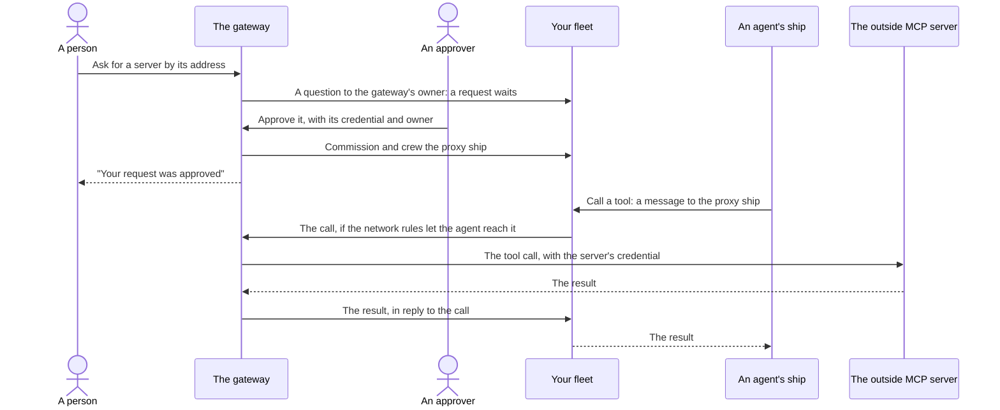
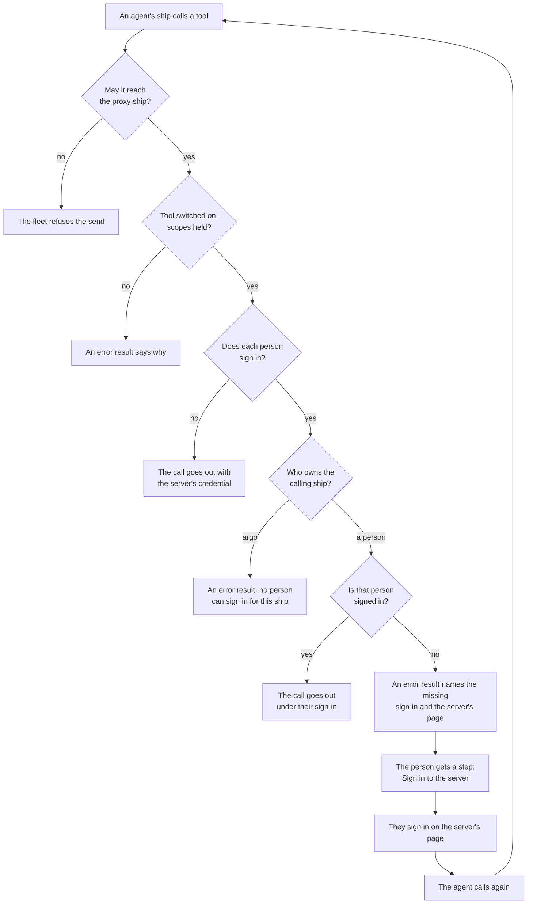

# Add an outside MCP server

Your agents can use the tools of an MCP server outside your [fleet](https://aeolus-fleet.dev/docs/words/#fleet): a CRM, a ticket tracker, a home automation server. The [gateway](https://aeolus-fleet.dev/docs/words/#gateway) brings such a server in as an [outside party](https://aeolus-fleet.dev/docs/words/#outside-party): someone asks for it by its address, an approver adds it with its credential, and a [proxy ship](https://aeolus-fleet.dev/docs/words/#proxy-ship) appears that every ship allowed to reach it calls like any other ship. This page covers turning outside parties on, asking, adding, who may call the server, and what a missing sign-in means.

## How a server joins and is called

The server never joins the fleet itself. The gateway [commissions](https://aeolus-fleet.dev/docs/words/#commission) and [crews](https://aeolus-fleet.dev/docs/words/#crew) a proxy ship for it, of type `mcp-server`, keeps the server's credential, and makes each call for it. Like every ship, the proxy ship has an [owner](https://aeolus-fleet.dev/docs/words/#owner), a person ship or `argo`, which answers for it.

## Before you start: turn outside parties on

A fleet's outside parties are off by default. While they are off, no outside MCP server or client reaches the fleet, nobody can ask for a server, and no request can be approved.

To turn them on you need the `fleet:network` [scope](https://aeolus-fleet.dev/docs/words/#scope):

1. In [Bridge](https://aeolus-fleet.dev/docs/words/#bridge), open **Outside parties**.
2. Press **Turn on**.
3. If your fleet applies no [network rules](https://aeolus-fleet.dev/docs/words/#network-rule), the gateway stops and warns you under **Open network**: every outside party would reach every ship. Press **Turn on anyway** to confirm, or **Keep off** and write a rule first.

With a network rule in place, an outside party reaches only the ships the rules allow, and only those ships reach it.

**Turn off** stops it again: the gateway takes no outside party's calls until it is turned back on.

## Ask for a server

Anyone signed in to the fleet from a chat can ask for a server by its address. From your chat, ask it to add the server, giving its `https` address, such as `https://mcp.example.com/mcp`; the chat calls `aeolus_ask_for_server` for you. Setting up the chat is on [Use your fleet from a chat](https://aeolus-fleet.dev/docs/use-your-fleet-from-a-chat/).

- Your request waits for an approver for 7 days, then expires.
- If someone already asked for the same server, you join their request instead of opening a second one.
- A server that is an outside party already is said so, with its name.
- An address that is not `http` or `https` is refused.

Once an approver decides, or the request expires, your [person ship](https://aeolus-fleet.dev/docs/words/#person) gets a message from the gateway's ship, such as "Your request for https://mcp.example.com/mcp was approved: it is the outside party crm." A request that expired says to ask again.

## Approve a request

An approver is anyone holding `gateway:approve`. When a request opens, the gateway's ship asks its owner a [question](https://aeolus-fleet.dev/docs/words/#question), "Someone asks to add ... to the fleet", pointing to Bridge. The question is withdrawn once the request is decided or expires. Any approver can decide; the first decision counts.

1. In Bridge, open **Settings**. Under **To decide**, open the request.
2. Fill in **Approve**:
   - **Proxy ship's name**: the name the fleet's ships see it under.
   - Its **owner**: a person ship or `argo`. It answers for this party.
   - **Scopes**: the scopes the proxy ship gets beside sending and receiving. You can grant only scopes you hold yourself.
   - **The server's credential**: **No credential** (the gateway sends none, for a server reached only on a private network), **Bearer token**, or **OAuth client credentials** (client id, client secret, issuer and an optional scope).
   - **Calls at once**: how many calls the server takes at the same time, 1 to 10, 4 by default.
3. Press **Approve**, or **Deny**.

The gateway commissions and crews the proxy ship, then tells everyone who asked. If the fleet refuses the proxy ship, the request stays waiting, undecided.

A server where each person signs in with their own account cannot be approved from a request: add it directly, as below.

## Add a server directly

A person holding `fleet:manage` adds a server without a request: in Bridge, open **Outside parties**, then **Add server**. Switching its tools as you add it also needs `gateway:approve`.

1. **Address**: the server's **Streamable HTTP address**, and **The server's credential**: one of the three above, or **Each person signs in**.
2. **Check**: press **Check the server**. The gateway lists the server's tools with the credential, and keeps nothing yet. A server it cannot reach is said so in place. With `gateway:approve`, switch each tool on or off here.
3. **Owner**: the proxy ship's name, its owner and **Calls at once**, then add it.

The proxy ship appears in the fleet. The gateway writes what it checked about it, such as the TLS host it reached, as verified facts beside its statement.

### A server where each person signs in

Some servers take only an OAuth sign-in. Choose **Each person signs in**: each person of the fleet then signs in to the server as their own outside account, and a ship's call goes out under its owner's sign-in.

The steps are **Address**, **Owner** and **Sign in**. There are no tools to check before someone signs in, so the gateway checks the server's sign-in when you press Add, and says a refusal in place. Then sign in to the server for yourself with **Sign in to** the server, or press **Later** and sign in from its page. Its tools show after the first sign-in.

**Not supported yet:** the gateway adds such a server only when its sign-in offers automatic client registration. A server whose sign-in does not, such as one that expects a fixed client id or a URL as its client id, is refused when you add it. That is [issue #348](https://github.com/ThomasHendrickx/aeolus-fleet-gateway/issues/348).

## Who may call it

A ship calls a tool by sending the proxy ship a message of content type `application/vnd.aeolus.mcp-tool+json; name=<tool>`, with the tool's arguments as a JSON object. The result comes back in reply, as `application/vnd.aeolus.mcp-result+json; name=<tool>`. The proxy ship's statement lists its tools, so discovery shows them to every ship that may reach it.

A call goes out only when all of these hold:

| Check | Who sets it |
| --- | --- |
| The calling ship may reach the proxy ship | The fleet's network rules. Label the proxy ship in the console so a rule can select it. |
| The tool is switched on | An approver, on the server's page. A tool the server adds later starts off. A call to a tool that is off is answered `tool not enabled for this party` and never reaches the server. |
| The calling ship holds the scopes the tool needs | An approver, with **Set scopes** on the server's page: scopes every tool needs, and scopes per tool. None are needed until someone sets them. |
| For a server where each person signs in: the calling ship's owner is signed in to it | Each person, on the server's page. |

The gateway reads the switches, the scopes and the owner again each time it hands a call over, so a change applies to calls already waiting.

## The sign-in a call goes out under

For a server where each person signs in, a ship's call goes out under the sign-in of the person who owns the asking ship. A person ship's own calls go out under that person's sign-in. A new owner of the proxy ship changes nobody's sign-in.

### The missing sign-in message

When the owner of the calling ship is not signed in, the server never sees the call. The agent gets an error result such as:

> alex, who owns the calling ship, has no working sign-in to crm: sign in on https://gateway.aeolus-fleet.dev/outside-parties/crm?fleet=..., then call again.

At the same time, the owner gets a [step](https://aeolus-fleet.dev/docs/words/#step) in Bridge, such as "Sign in to the outside party crm", that links to the server's page. They are asked once per server, and again only after a sign-in in between. Signing in finishes the step by itself: there is nothing to press afterwards. The agent then calls again.

The same message comes when a sign-in ended: the server refused to refresh it, or someone removed it. The step then says the sign-in ended and why. Two other error results are close to it:

- **No person can sign in for a ship `argo` owns.** Such a ship calls the server once a person owns it.
- **The sign-in lacks a scope the server needs.** The server refused the call; the person signs in again on the server's page, and their sign-in is kept meanwhile.

The gateway keeps each sign-in alive, refreshing it before it ends, so a person signs in once and stays signed in while the server allows it.

### Sign in, and manage sign-ins

On the server's page, under **Outside parties** in Bridge, your own sign-in sits between its facts and its tools: not signed in with **Sign in**; signed in with the outside account, when, and when last used, with **Sign in again** and **Remove**; or ended, with when and why. You need a person ship to sign in.

When the browser comes back, the page says how it went:

| What the page says | What it means |
| --- | --- |
| You are not signed in: the sign-in was cancelled or refused there | You declined, or the server refused. Press Sign in again. |
| The sign-in did not finish | Press Sign in again. |
| That account is another person's sign-in in this fleet | Each outside account signs in for one person only. Sign in as your own. |
| The server's sign-in did not answer | Try again in a moment. |

An approver sees everyone's sign-ins below their own, each person with their outside account, state and last use, and can **Remove** any of them. Removing a sign-in revokes it at the server where the server allows it.

## When a call does not go through

The gateway keeps every call, so a restart neither loses one nor makes one twice.

- **The server could not be reached, or refused the credential.** The call is handed again after a wait, and the fleet stops it at the fifth attempt.
- **The call went out and no answer came** (a broken connection, or no answer within 5 minutes). The tool may have run, so the gateway does not call it again unless `argo` marked the tool repeatable. The call shows in the console's **Needs attention** with why, for someone who can check the outside system to resend or dismiss it.
- **The server is busy.** A server takes at most its **Calls at once**; the rest wait their turn.

## Change or remove a server

On the server's page, a person with the scope for it can change the proxy ship's owner (`fleet:owner`), change its scopes (`scopes:grant`, only scopes they hold), or retire it (`fleet:manage`). Retiring it ends every sign-in to it. Adding it again is a new request.

## If something does not work

| What you see | What to do |
| --- | --- |
| Asking says the fleet's outside parties are off | Someone with `fleet:network` turns them on, under **Outside parties**. |
| Turning outside parties on asks you to confirm an open network | Your fleet has no network rules. Write one first, or confirm with **Turn on anyway**. |
| A request waits and nobody decides | Ask a person holding `gateway:approve`. It expires after 7 days. |
| Adding a server says its sign-in offers no automatic client registration | Not supported yet: [issue #348](https://github.com/ThomasHendrickx/aeolus-fleet-gateway/issues/348). |
| An agent gets the missing sign-in message | The person who owns the agent's ship signs in on the page the message names, then the agent calls again. |
| An agent gets `tool not enabled for this party` | An approver switches the tool on, on the server's page. |
| An agent cannot send to the proxy ship at all | Your network rules do not let its ship reach it. Label the proxy ship and add a rule. |

## Next

- [Use your fleet from a chat](https://aeolus-fleet.dev/docs/use-your-fleet-from-a-chat/): sign in from a chat, where you ask for a server.
- [Bridge and the app](https://aeolus-fleet.dev/docs/bridge-and-the-app/): where the requests, the steps and the server's page live.
