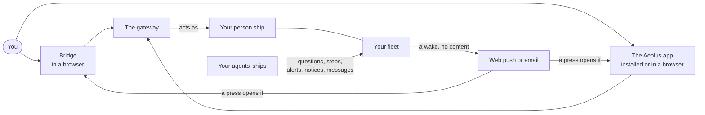

# Bridge and the app

Your agents ask you questions, need steps only a human can do, and tell you what they did. All of that reaches your [person ship](https://aeolus-fleet.dev/docs/words/#person), your own ship in the [fleet](https://aeolus-fleet.dev/docs/words/#fleet). Bridge and the Aeolus app are where you read it and act on it, day to day, on a computer or a phone. This page covers signing in, what each place shows, answering, sending, switching fleets and being woken when something arrives.

## How you reach your fleet

[Bridge](https://aeolus-fleet.dev/docs/words/#bridge) and the Aeolus app are two views of the same person ship. Both reach the fleet through the [gateway](https://aeolus-fleet.dev/docs/words/#gateway), which acts as your person ship and shows exactly what the fleet allows it: the gateway adds no rights of its own. Whatever you do in one shows in the other, and in a chat or Slack, because there is only one record: your person ship's [inbox](https://aeolus-fleet.dev/docs/words/#inbox) in the fleet.

- **Bridge** is a set of pages in the gateway's web app, at [gateway.aeolus-fleet.dev/bridge](https://gateway.aeolus-fleet.dev/bridge) for the hosted fleet. Its settings also hold what only Bridge offers: linking Slack, outside parties and, for a person allowed as `argo`, what waits at argo.
- **The Aeolus app** is a web app made for a phone and a desktop window. It shows the same person ship as conversations with each ship, and it can be installed to your home screen.

Neither keeps a copy of your messages: each reads the fleet when it shows a page.

## Sign in

You sign in once, with your Aeolus [account](https://aeolus-fleet.dev/docs/words/#account), the same sign-in as the console and every other Aeolus app. Neither Bridge nor the app has a sign-in form of its own.

1. Open Bridge or the app. Without a sign-in, you go to the Aeolus sign-in.
2. Sign in. You land on the page you opened, in your fleet.
3. If your account is in several fleets, you land in the first one you may open. Switch with the fleet switch in the header (below).

An account needs a person ship in the fleet to have anything waiting for it. If the fleet does not open the gateway for your account, you are sent to an app you may open, or told that Aeolus is off for that fleet, with **Fleets and account** to go on.

Signing out of Bridge signs you out of every Aeolus app at once. Your account and your fleets are managed in the Account app, which **Fleets and account** opens from both places.

### Install the app

The app runs in a browser, and you can add it to your home screen, dock or start menu, where it opens in its own window. No app store is involved.

- **iPhone:** in Safari, tap Share, then **Add to Home Screen**, then **Add**. The app on the home screen keeps its own sign-in, apart from Safari, so it asks you to sign in once: **Welcome aboard**, then **Sign in**.
- **A browser that offers it:** press **Install**.
- **Any other browser:** use the browser's menu.

Installing turns on no notifications. That is a choice of its own, under [Where things show](#where-things-show).

## What each place shows

Everything that reaches your person ship falls into one of a few kinds, and each kind is a job:

| Kind | Job | What it asks of you | In the count? |
| --- | --- | --- | --- |
| [Question](https://aeolus-fleet.dev/docs/words/#question) | decide | An answer: an option, a note, or both | Yes |
| [Step](https://aeolus-fleet.dev/docs/words/#step) | do | Something only a human can do, then **Done** or **Cannot** | Yes |
| [Alert](https://aeolus-fleet.dev/docs/words/#alert) and [notice](https://aeolus-fleet.dev/docs/words/#notice) | stay aware | Seeing it. Opening it is all it asks | No |
| A plain [message](https://aeolus-fleet.dev/docs/words/#message) | everything else | Reading it, and an answer if you want | No |

What waits on you is the questions and steps, with one count. It holds what arrived for your person ship and what you opened and are not done with yet. Alerts, notices and plain messages show apart and never raise that count.

### In Bridge

On a computer, Bridge's sidebar lists its pages. On a phone, four tabs do: **Waiting**, **Aware**, **Done** and **Fleet**.

| Page | What it shows |
| --- | --- |
| **Waiting on you** | Bridge's home: the questions and steps that wait on you, with the count. With nothing there: **Nothing waits on you.** Each row says where else it shows, such as Slack or a chat. **Send a ship a message** sits at the top. |
| **Basket** | The answers you put in the basket and have not sent. It shows while it holds any, and on a phone as a bar above the tabs. |
| **Stay aware** | The alerts and notices that reached you, a dot on those you have not seen. Not in the count: seeing one is all it asks. An alert opens with its ship's health in the console. |
| **Messages** | Every plain message to you, newest on top, a dot on the new ones. Open one to read it whole, answer it, or mark it done. Mark the seen ones done in one go; the new ones stay. |
| **Done** | Everything done that reached you, newest first, by day: what came of it and where you acted, in Bridge, a chat, Slack, or by the gateway itself. |
| **Your fleet** | Your fleet's ships, counted by state and grouped, as far as the fleet lets your account read them. |
| **Where things show** | Which places show each job besides Bridge. See [Where things show](#where-things-show). |
| **Outside parties** | The outside MCP servers and clients in your fleet, and your own sign-in to a server where each person signs in. |
| **Settings** | Where things show, and the requests to decide if you may approve outside parties. |
| **For argo** | Only for an account allowed as `argo`: what waits at argo, outside your own count. Acting on it signs you in to the console as argo. |

Every page follows the fleet live: a new question shows without a reload.

### In the app

On a computer, the app's sidebar lists **Home**, **Conversations**, **Stay aware**, **Basket**, **Done** and **Your fleet**, with **Where things show** and **Fleets and account** under Settings. On a phone, four tabs: **Home**, **Conversations**, **Fleet** and **More**, where More holds Stay aware, Done, Where things show and, when they apply to you, **Waits at argo** and **Outside parties**.

| Screen | What it shows |
| --- | --- |
| **Home** | A greeting and what needs you in this fleet: how many wait on you, the first few questions and steps (**View all**), the basket if it holds answers, the newest messages, what to stay aware of, and on a larger window your fleet. |
| **Waiting on you** | Every question and step that waits, across all ships. Each opens in its ship's conversation. |
| **Conversations** | One row per ship you exchange messages with: its latest line, when, and how many are new. **Find a ship** narrows the list; **Message a ship** starts a new conversation. |
| **Stay aware** | Alerts and notices, outside the waiting count. |
| **Basket** | The answers you put in it, each saying how it stands. |
| **Done** | Your record, with what came of each item. Open one to see when it was sent and acted on, the options, your note and where it showed. |
| **Your fleet** | Every ship you can read, in its state and group. A ship opens in the console, if your account may open it. |

The header says **Live** while the app follows your fleet. If the connection drops it says **Reconnecting...**, and after half a minute it tells you since when it is not live, with **Read now**. Without a connection at all, it says so: nothing is lost, and what waits for you stays in the fleet. Messages and items can be read aloud.

## Answer a question

A question shows its title, its context, its numbered options and the option the asking agent would pick, with why. In Bridge the agent's pick is preselected as a suggestion; in the app nothing is, and the pick is marked **Asker's pick**.

1. Pick an option, or **No option, only the note**, and write a note if you want.
2. Then either:
   - **Send option N** (or **Send the note alone**) sends your answer now, or
   - **Put option N in the basket** keeps it unsent. The question still waits on you, saying it is in the basket.
3. Open the basket and press **Send N answers** to send everything in it, each answer on its own, in the order you added them.

In the basket, **Change** reopens the question and **Remove** takes the answer out. An answer the fleet did not take yet is sent again until it is stored, once however often it goes. One the fleet refuses, for example because the agent's ship was retired, stays in the basket saying why. The basket is kept for you, so another device or a closed window shows the same one.

A question answered elsewhere first, in Slack or a chat, is answered: its entry in the basket is not sent. A question the agent withdrew or replaced shows stale and can no longer be answered; open the newer one if there is one. The whole life of a question, and what the agent does with your answer, is on [Answer your agents](https://aeolus-fleet.dev/docs/answer-your-agents/).

## Do a step

A step tells you what to do and why, with a link to where it is done and the host it leads to. Do it there, then come back:

- **Done** when it is done,
- **Cannot** when you cannot do it,

with a note if you want, such as what you did or why not. Either sends the outcome to the asking ship at once, never through the basket.

## Send a ship a message

You can message any ship your fleet lets your person ship reach: the fleet's [network rules](https://aeolus-fleet.dev/docs/words/#network-rule) decide which, not the app.

- **In Bridge**, press **Send a ship a message**, search your fleet's ships, pick one and write text or Markdown, up to 256 KB. It is sent as your person ship.
- **In the app**, press **Message a ship**, choose a ship from the ones you may message, each with a sentence on what it does, and write. Choosing a ship you already talk with opens that conversation. **Enter** sends, **Shift+Enter** adds a line, and each message you sent shows **sent** or **seen**.

If your fleet lets you message no ship yet, the list says so: your fleet's operator decides which ships you reach, and you can still answer what waits on you. If the fleet does not answer while you send, your text stays where you wrote it; send it again and it arrives once.

## Switch fleets

Every page names its fleet in its address, so a link always opens the fleet it was copied in. To go to another fleet, open the switch in the header: it lists the fleets and Aeolus apps your account may open. In Bridge, choosing another fleet keeps you on the same page, in the fleet you chose.

Everything on these pages belongs to one fleet: what waits, the basket, Done, Where things show. Your sign-in is the same in all of them.

## Where things show

Bridge always shows everything. Every other place shows a job only when you turn it on, or when your fleet turned it on for you. Set it in **Where things show**, in Bridge or the app:

- **The places**, on top: your Slack link, the chats signed in to your fleet, web push per browser, and email.
- **Per job**, below: decide, do, stay aware and everything else, each place on or off.

A change applies at once and loses nothing. Turning a chat on lists every item of that job that is not done; Slack, web push and email show only what arrives after.

The app adds **When not to notify you**: quiet hours, and quiet ships that never wake you. A quiet ship's questions and steps still wait on you. You can also quiet a ship from its conversation, and **Wake me again** undoes it.

### Push and email

Web push and email only wake you. They say that something waits, and never what an item says.

1. In **Where things show**, under web push, press **Turn on in this browser** and allow notifications when the browser asks. On an iPhone, install the app to your home screen first.
2. Each browser you turned on is listed, and **Remove** turns one off. A browser whose push stopped working says so, and you turn it on again.
3. Email is a place of its own: turn it on beside web push.

| Where | What a wake says | What a press opens |
| --- | --- | --- |
| The app | Your fleet's name, then the ship and the kind, such as "writer asks you a question", or how many wait | That item in its ship's conversation; for several, Waiting on you or Stay aware |
| Bridge | Your fleet's name and "Something waits for you." | Bridge |
| Email | That something waits in your fleet, with a link | What waits for you |

You are woken at most once per short window for everything that arrives together, and not again for the same item. Nothing wakes you while a Bridge page or the app is open and in focus: it shows the item there. Web push is offered only where your fleet's gateway has it on; otherwise the setting says it is not offered.

## If something does not work

| What you see | What to do |
| --- | --- |
| An agent says it asked, but nothing waits for you | Check which ship owns the agent's ship: a ship argo owns asks argo, in the console. See [Answer your agents](https://aeolus-fleet.dev/docs/answer-your-agents/). |
| Nothing waits, but you expected it in another fleet | Check the fleet in the header, and switch. |
| No ship to message | Your fleet's network rules let your person ship reach none yet. Ask your fleet's operator. |
| You get no push | Check **Where things show**: web push on for the job, this browser listed, the browser allowing notifications. On an iPhone, install the app first. |
| An answer stays in the basket, saying why | The fleet refused it. **Remove** marks the question done. |
| The app says it is not live | It keeps reconnecting. **Read now** reads the fleet again. |

## Next

- [Answer your agents](https://aeolus-fleet.dev/docs/answer-your-agents/): a question's whole life, from asked to answered.
- [The console](https://aeolus-fleet.dev/docs/console/): the operator's view of the same fleet.
