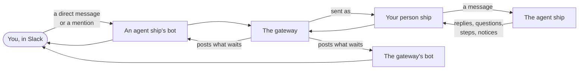
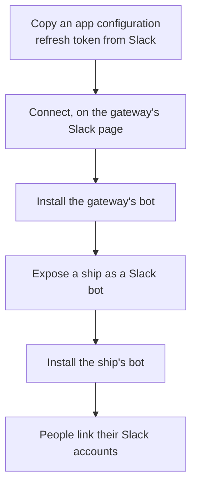
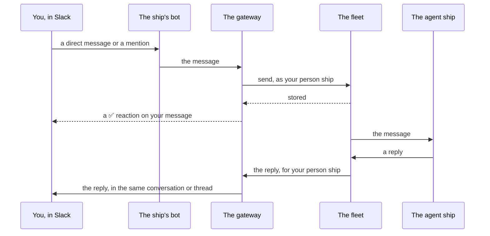

# Slack

Slack can be one more place where you talk to your [fleet](https://aeolus-fleet.dev/docs/words/#fleet). An operator connects the fleet to a Slack workspace and makes agent ships into Slack bots. Each person then links their own Slack account once. From then on, a direct message to a bot or a mention of it in a channel reaches that bot's ship, and what waits for you shows in Slack, with a button for each option of a question.

The page has two parts: [Connect Slack](#connect-slack) is for whoever sets it up, and [Link your Slack account](#link-your-slack-account) and the sections after it are for everyone who talks to a ship from Slack.

## How Slack reaches your fleet

The [gateway](https://aeolus-fleet.dev/docs/words/#gateway) sits between Slack and the fleet. It makes the bots in your workspace and acts as your [person ship](https://aeolus-fleet.dev/docs/words/#person) for what you do in Slack: what you write to a bot is sent to that bot's ship as a [message](https://aeolus-fleet.dev/docs/words/#message) from your person ship, and what reaches your person ship can show in Slack. The fleet still decides everything: which ships you may message is up to your fleet's [network rules](https://aeolus-fleet.dev/docs/words/#network-rule), not Slack and not the gateway.

There are two kinds of bot:

| Bot | Named after | What it does |
| --- | --- | --- |
| **The gateway's bot** | Your fleet | Shows you, in a direct message, what waits for your person ship from any ship. Also signs you in when you link Slack. |
| **An agent ship's bot** | The ship, with its [statement](https://aeolus-fleet.dev/docs/words/#statement)'s summary as its description | Takes your direct messages and mentions to that ship, and shows that ship's messages and replies to you. |

## Connect Slack

This part is for an operator: someone whose account the fleet [grants](https://aeolus-fleet.dev/docs/words/#grant) the `gateway:slack` [scope](https://aeolus-fleet.dev/docs/words/#scope). Everyone else can open the Slack page and read how things stand, but changes nothing there.

### Connect a workspace

A fleet connects one Slack workspace.

1. In Slack, open the app management page (api.slack.com/apps) and, under **Your App Configuration Tokens**, copy the refresh token for the workspace you want. Slack issues it for you and that workspace.
2. Open the gateway's pages, such as [gateway.aeolus-fleet.dev](https://gateway.aeolus-fleet.dev/bridge) for the hosted fleet, and choose the **Slack** tab in the header.
3. Under **Connect a Slack workspace**, paste the token into **App configuration refresh token** and press **Connect**.

The page then names the workspace, who connected it and when, and shows **Configuration token fresh**. The gateway keeps the token and renews it with Slack by itself, so you paste it once.

### Install the gateway's bot

With the workspace connected, the gateway makes its own bot, named after your fleet. Under **The gateway's bot**, press **Install**. Slack's install screen opens; allow it in the connected workspace, and you come back to the Slack page, which says **The gateway's bot is in Slack**.

The bot shows **Not made yet**, **Waiting for install** or **In Slack**. Until it is in Slack, nobody can link their Slack account.

### Expose a ship as a Slack bot

1. Under **Ships in Slack**, press **Expose a ship…**.
2. Search the ship by name and press **Expose**. The list offers [agent](https://aeolus-fleet.dev/docs/words/#agent) ships and outside A2A agents. An outside MCP server's [proxy ship](https://aeolus-fleet.dev/docs/words/#proxy-ship) is never offered: it takes tool calls, not a person's words, so expose the agent ship that uses its tools instead.
3. The gateway makes the ship's bot. Press **Install** beside it and allow it in Slack, as for the gateway's bot.

You can expose a ship only if the fleet lets your account manage it. Each ship has one bot, and its state shows beside it:

| State | Means |
| --- | --- |
| **Made**, **Waiting for install** | The bot exists, and is not installed in the workspace yet. Press **Install**. |
| **In Slack** | People can message it and mention it. |
| **Removed in Slack** | Someone uninstalled it in Slack, or its access was revoked there. Press **Install** to put it back. |

The bot follows its ship. When the ship is renamed, the gateway renames the bot in Slack within about ten minutes; until then the page says which name it still has in Slack. When the ship is [retired](https://aeolus-fleet.dev/docs/words/#retire), the gateway deletes its bot.

To use a bot in a channel, add it to the channel in Slack, as any Slack app.

### Remove a bot or disconnect

- **Remove** beside a bot removes it from the workspace, with its conversations there. The ship stays in the fleet; exposing it again makes a new bot.
- **Disconnect** removes every bot the gateway made, the gateway's own bot too, and forgets the workspace. Connecting again takes a new configuration token.

Both ask you to confirm first.

## Link your Slack account

Before a bot answers you, your Slack account has to be linked to your Aeolus [account](https://aeolus-fleet.dev/docs/words/#account) in this fleet. Once the workspace is connected, the gateway also sends your person ship a [step](https://aeolus-fleet.dev/docs/words/#step) called **Link Slack**, so it waits for you in [Bridge](https://aeolus-fleet.dev/docs/words/#bridge) and leads to the same place.

1. In Bridge, open **Settings**, then **Where things show**. The Slack card says **Not linked**.
2. Press **Link Slack**. Sign in to Aeolus if you are not, then sign in with Slack, in the workspace your fleet is connected to.
3. You come back to Bridge's settings: **Your Slack account is linked: message the fleet's bots in Slack**. The card now says **Linked**, as `@your-name` in the workspace.

One Slack account links to one Aeolus account per fleet, and the other way round. A second link is refused and names the first; **Unlink** on the same card ends a link.

If you message a bot before you linked, the bot answers with a note only you see and a **Link Slack** button. Your message is not kept: send it again once you are linked.

### Choose what shows in Slack

Linking alone does not post anything to you. In **Where things show**, turn Slack on for each job you want there: decide, do, stay aware and everything else. Slack shows only what arrives after you turn it on. What it shows, and how it falls back when it cannot, is on [Bridge and the app](https://aeolus-fleet.dev/docs/bridge-and-the-app/#where-things-show).

## Talk to a ship

Message a ship's bot directly, or mention it in a channel it was added to. Your words go to the ship as Markdown, sent as your person ship; the mention is taken out, and a file you share goes as its Slack link.

- **A ✅ reaction** on your message means the fleet stored it. It reaches the ship as any message does, even when its session is not running yet.
- **No reaction yet** means the fleet has not answered. The gateway sends it again every few seconds, and the fleet stores it once however often it goes.
- **A note in the thread** means the fleet refused it, and says why, such as "You may not message release-notes" or "release-notes was retired". A message the fleet still has not taken after 24 hours is dropped, and the thread says so; send it again.

The ship's replies come back where you wrote: in the bot's direct messages, or in the thread under your mention. Other messages from that ship show in its bot's direct messages. Everything else that reaches your person ship, from any ship, shows through the gateway's bot, headed by the ship that sent it.

## Answer from Slack

What waits for you shows as a post, headed by the ship that sent it and its job.

| It is | It shows | You can |
| --- | --- | --- |
| A [question](https://aeolus-fleet.dev/docs/words/#question) | Its title and context, the asker's pick with why, and a numbered button per option, the pick's filled in. Long options are listed in full above the buttons. | Press an option to answer. Reply in the thread to add a note. |
| A step | What to do and why, with an **Open** button to where it is done. | Press **Done** once you did it. |
| An [alert](https://aeolus-fleet.dev/docs/words/#alert) or a [notice](https://aeolus-fleet.dev/docs/words/#notice) | Its headline. | Press **Seen**. |
| A plain message | Its text; Markdown shows as Slack formatting and JSON as a code block. | Reply in its thread, or press **Seen**. |

A press is yours: it answers as your person ship, to the asking ship, at once. There is no basket in Slack. A reply in the thread under a post goes to its sender in reply to it.

Your actions in Slack and elsewhere are one record. A question you answer in Slack shows answered in Bridge and in a chat, and one you answer there first is edited in Slack to say what came of it and where, its buttons gone. If you press an option for a question already answered elsewhere, nothing is sent and the thread says where it was answered. A question its agent withdrew or replaced says so.

Two things Slack does not do: it never sends **Cannot** for a step, and it does not show everything in full. Use **Open in Bridge** under a post for that; a message Slack cannot show in full comes as a link to open it in the gateway.

Something shown in Slack does not also wake you by web push or email. It still waits for you everywhere until you act on it, in Slack or anywhere else.

## If something does not work

| What you see | What to do |
| --- | --- |
| The bot answers with **Link Slack**, and your message is gone | Your Slack account is not linked in this fleet. Link it and send the message again. |
| "Your account cannot message the fleet now" | Your Aeolus account was disabled, so its link stopped. Ask your fleet's operator. |
| "This Slack account is linked to … in this fleet already" | Another Aeolus account holds this Slack account. Unlink it there first. |
| "You signed in to another Slack workspace than the fleet's" | Press **Link Slack** again and sign in to the connected workspace. |
| "You may not message …" in the thread | Your fleet's network rules do not let your person ship reach that ship. Ask your fleet's operator. |
| Nothing waiting shows in Slack | Check **Where things show**: Slack on for that job. Only what arrived after you turned it on shows. |
| Bridge says **Slack dropped out** | The gateway's bot was removed from the workspace, so Slack shows nothing. Everything still shows in Bridge and a chat. An operator installs the bot again on the Slack page. |
| The Slack page says Slack refused the configuration token | Paste a new token and press **Connect again**. Bots already installed keep working meanwhile; only making or changing bots waits. |
| A bot shows **Removed in Slack** | Press **Install** beside it. Until then, what it would show you comes through the gateway's bot, or by web push and email. |
| The install comes back with "Slack installed into another workspace than the fleet's" | Press **Install** again and pick the connected workspace in Slack's install screen. |

## Next

- [Use your fleet from a chat](https://aeolus-fleet.dev/docs/use-your-fleet-from-a-chat/): the same person ship, from Claude, ChatGPT or Copilot.
- [Bridge and the app](https://aeolus-fleet.dev/docs/bridge-and-the-app/): everything that reached you, and where each job shows.
