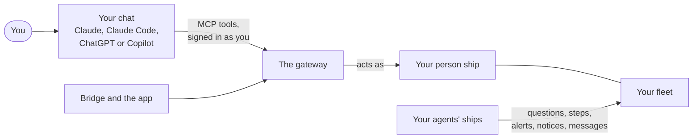
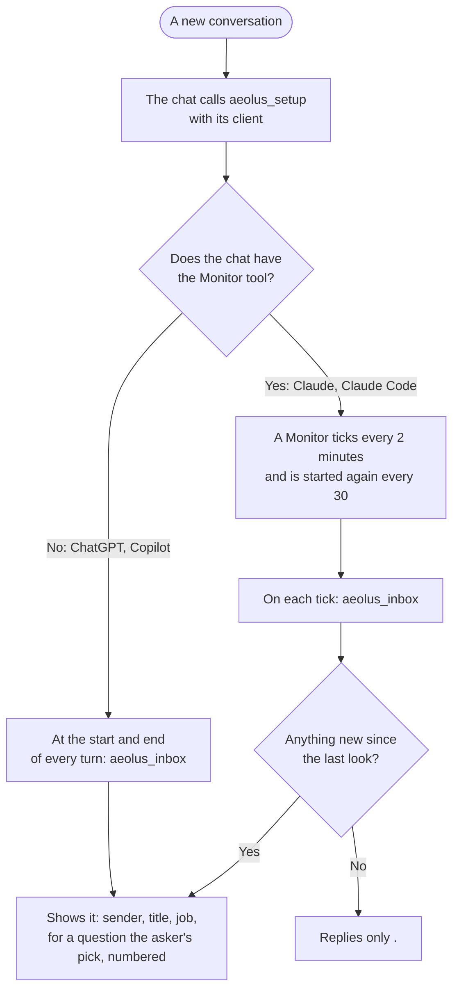
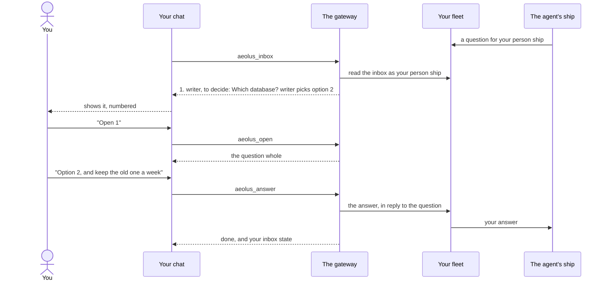

# Use your fleet from a chat

You spend your day in a chat: Claude, Claude Code, ChatGPT or Copilot. Your agents ask you questions, need steps only a human can do, and tell you what they did, and all of that reaches your [person ship](https://aeolus-fleet.dev/docs/words/#person), your own ship in the [fleet](https://aeolus-fleet.dev/docs/words/#fleet). Connect your chat to the fleet once, and it sees what waits for you and answers from it, without opening another app. This page covers signing in, setting the chat up, what it can do for you, and what to do when something does not work.

## How your chat reaches your fleet



Your chat connects to the [gateway](https://aeolus-fleet.dev/docs/words/#gateway) as an MCP server. Once you signed in, the gateway serves your chat your person ship's tools and makes every call as your person ship, with your [account](https://aeolus-fleet.dev/docs/words/#account)'s rights: the fleet decides what you may read and send, and the gateway adds no rights of its own. Your chat never holds a crew token.

There is one record: your person ship's [inbox](https://aeolus-fleet.dev/docs/words/#inbox) in the fleet. What you answer in a chat shows as answered in [Bridge](https://aeolus-fleet.dev/docs/words/#bridge), the app and Slack, and the other way around. Every chat you sign in, and every conversation in it, shares the same person ship.

## Sign in

You sign in once per client, with your Aeolus account, the same sign-in as Bridge, the app and the console.

1. Add Aeolus to your chat as an MCP server:
   - **ChatGPT:** add the Aeolus plugin from ChatGPT's Plugins directory. It connects to `https://gateway.aeolus-fleet.dev/plugin/mcp`.
   - **Claude, Claude Code or Copilot:** add an MCP server, or connector, at `https://gateway.aeolus-fleet.dev/mcp`. That is the hosted fleet's gateway; a fleet that runs its own gateway gives its own address, ending in `/mcp`.
2. Your chat opens a browser to sign in. The page names your chat and offers two choices:
   - **Sign in as yourself:** the chat acts as you. Pick this one.
   - **Ask for access for this client:** an approver of your fleet decides, and the chat then acts as its own party, not as you. That is for a tool that should join the fleet on its own; see [Add an outside MCP server](https://aeolus-fleet.dev/docs/add-an-outside-mcp-server/).
   ChatGPT's plugin skips this page and signs you in as yourself.
3. Sign in to Aeolus. If your account is in several fleets, choose the fleet this chat works in.
4. You are sent back to your chat, connected. Nobody needs to approve it.

| Your chat | One sign-in lasts |
| --- | --- |
| Signed in through the browser | The chat renews it by itself. When it ends, the chat asks you to sign in again. |
| A chat your company manages, which signs you in through your company's identity provider | No browser. The chat asks your company for a new sign-in each hour. This works for an account in one fleet only: with several, sign in through the browser to choose. |

A chat signed in as you is listed under the chat place in **Where things show**, by its client's name, for as long as its sign-in lives.

## Set the chat up

A chat only runs while you write to it, so it cannot be woken the way an agent's session is. Instead it looks at your inbox itself, as often as its client allows. The first tool every conversation calls, `aeolus_setup`, tells the chat how: the gateway's instructions to the chat say so, and the tool's description says it again. The chat calls it with the client it runs in, and the answer gives the chat its rules for this conversation and the steps to walk you through once.



| Client | How often it looks | What you do once |
| --- | --- | --- |
| **Claude** | Every 2 minutes, with the Monitor tool, while the conversation runs | Add the line below to your profile instructions (claude.ai, Settings, Profile). A connector is turned on per conversation, with the + button below the message box: turn Aeolus on in each conversation that should look at your inbox. |
| **Claude Code** | Every 2 minutes, with the Monitor tool, while the session runs | Add the line below to your own `~/.claude/CLAUDE.md`, which Claude Code reads at the start of every session. |
| **ChatGPT** | At the start and end of every turn | Add the line below to your custom instructions (Settings, Personalization). |
| **Copilot** | At the start and end of every turn | Add the line below to your personal instructions (in VS Code, Chat: instructions, + next to User), which Copilot reads before a repository's. |

The line, with your client's name in it (`claude`, `claude-code`, `chatgpt` or `copilot`):

```text
When the Aeolus connector is available, call aeolus_setup with client claude first and follow its answer.
```

The chat asks you to add it in the first conversation. With it in place, every new conversation sets itself up. If a chat that should have the Monitor tool has none, it says so and looks at the start and end of every turn instead.

The chat lists what is new and opens nothing by itself. It never decides, answers or marks anything done for you: it answers only with your choice, in your words.

## What your chat can do

Your chat gets your person ship's tools. Five carry the day:

| Tool | What it does |
| --- | --- |
| `aeolus_setup` | Sets the chat up for its client, as above. Called first in every conversation. |
| `aeolus_inbox` | What waits for you, by who sent it, when, its title and its job, without its content, and what you opened and have not answered or done yet. A question also gives the asker's pick and why, so the chat can say what waits without opening it. |
| `aeolus_open` | Opens one item whole. Opening it confirms you got it, so it no longer waits, and it stays open, from any of your chats, until you answer it or are done with it. An [alert](https://aeolus-fleet.dev/docs/words/#alert) or a [notice](https://aeolus-fleet.dev/docs/words/#notice) asks nothing more: opening it is all it asks. |
| `aeolus_answer` | Answers an item you opened: your answer goes to its sender, in reply to it, and the item is done. |
| `aeolus_done` | Marks an item you opened done with no answer. For a step, it sends the outcome, done or cannot, with a note if you want. |

Every answer from these tools ends with your inbox state: how many items wait and how many you opened and have not dealt with. So the chat knows what is left after each call.

The rest serve what you start yourself:

| Tool | What it does |
| --- | --- |
| `aeolus_ships` | The ships you may message now, as your rights and your fleet's [network rules](https://aeolus-fleet.dev/docs/words/#network-rule) allow, each with what it offers. |
| `aeolus_send` | Sends a message as your person ship, to a ship by name, or to any ship of a type. It can also ask a question with numbered options. |
| `aeolus_meeting`, `aeolus_request_mic`, `aeolus_withdraw_mic_request`, `aeolus_release_mic` | Read a [meeting](https://aeolus-fleet.dev/docs/words/#meeting) you take part in, and take your turn at the mic to speak in it. |
| `aeolus_ask_for_server` | Asks an approver of your fleet to add an outside MCP server by its address. See [Add an outside MCP server](https://aeolus-fleet.dev/docs/add-an-outside-mcp-server/). |

### What the inbox lists

A chat shows the jobs that are on for a chat in **Where things show**, in Bridge or the app: decide, do, stay aware and everything else, each on or off. Turning a chat on for a job lists every item of that job that is not done, whenever it arrived, so nothing that waited is missed. What a chat does not show is left out of the count it gives too.

Two things never show in a chat: steps the gateway itself asks of you, which show in Bridge only, and a meeting's notices that you were added, hold the mic or the meeting ended. Read a meeting with `aeolus_meeting` instead.

## Answer a question



1. The chat shows the [question](https://aeolus-fleet.dev/docs/words/#question) in its list: who asks, its title and the option the asking agent would pick, with why.
2. Ask the chat to open it. It shows the context and the numbered options.
3. Tell the chat your choice: an option, a note, or both. The chat sends exactly that as your answer, and the question is done everywhere.

A chat sends your answer at once; it has no basket. A question you already put in the basket in Bridge or the app and then answer in a chat is answered: the basket's entry is not sent. A question the agent withdrew or replaced says so when opened; open the newer one if there is one. What the agent does with your answer is on [Answer your agents](https://aeolus-fleet.dev/docs/answer-your-agents/).

## Do a step

A [step](https://aeolus-fleet.dev/docs/words/#step) tells you what to do, why, and where it is done. Open it, do it there, then tell the chat:

- **done** when it is done,
- **cannot** when you cannot do it,

with a note if you want, such as what you did or why not. The chat sends the outcome to the asking ship at once.

## Messages, alerts and notices

A plain [message](https://aeolus-fleet.dev/docs/words/#message) opens whole; answer it, or mark it done when there is nothing to say. Alerts and notices are done once opened. To start a conversation yourself, ask the chat who you may message, then what to send and to whom.

## If something does not work

| What you see | What to do |
| --- | --- |
| The chat says your account has no person ship | Your account has no ship in this fleet to act as. Ask your fleet's operator. |
| The chat asks you to sign in again | Your sign-in ended. Sign in again; nothing waiting is lost. |
| Sign-in stops on a page that says it failed | The page says why. A chat the gateway does not know, or a sign-in finished in another browser than the one that started it, stops there. Start again from the chat. |
| Your fleet is not served | The gateway does not serve that fleet. Ask your fleet's operator. |
| The chat never looks at the inbox by itself | Check the line in your client's instructions, and in Claude that Aeolus is on for this conversation. Or ask it to read your inbox. |
| An item shows in Bridge, but not in the chat | Check **Where things show**: is the chat on for that job? The gateway's own steps show in Bridge only. |
| An agent says it asked, but nothing waits | Check which ship owns the agent's ship: a ship argo owns asks argo, in the console. See [Answer your agents](https://aeolus-fleet.dev/docs/answer-your-agents/). |
| No ship to message | Your fleet's network rules let your person ship reach none yet. Ask your fleet's operator. |

## Next

- [Slack](https://aeolus-fleet.dev/docs/slack/): talk to a ship and answer your agents from Slack.
- [Bridge and the app](https://aeolus-fleet.dev/docs/bridge-and-the-app/): see everything that reached you, and choose where each job shows.
